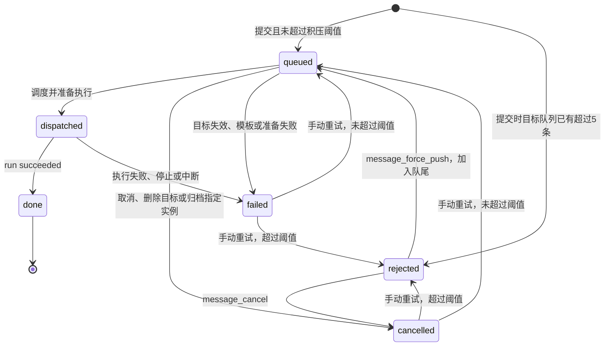

# 消息队列与运行状态

消息记录提交与投递，run 记录一次模型执行；一个消息可以有多次手动重试的 run。入队成功不代表模型已经启动或任务已经完成。

## 队列身份与顺序

| 消息目标 | 积压统计 | 执行约束 |
| --- | --- | --- |
| fork 逻辑短 ID | 每条新建会话，不汇总其他实例积压 | 独立实例可并行；共用 direct 目录仍串行 |
| 真实实例长 ID | 该实例的 queued 消息 | 同一实例 FIFO、串行 |
| resident 逻辑短 ID | 与常驻实例共用计数；首次创建前也有独立的待建队列 | 创建或复用常驻实例；显式 instance_fork 不进入此队列 |

提交前已有 5 条 queued 仍接受第 6 条；已有 6 条时拒绝下一条。running/dispatched、rejected、done、failed、cancelled 不计入积压。新提交与手动重试使用同一检查；强推明确绕过积压限制，但仍检查发送者、目标和 rejected 状态。

新消息、成功重试与强推都取得新的 queue_seq，排到队尾。顺序保证作用于同一实例、待建 resident 队列或共用 direct 目录，不是所有实例的全局串行。暂停 group 保留队列，其消息不会阻塞其他 group 共用目录的调度。

逻辑目标在调度时按当前配置解析。更新 run_mode、更新配置、续换 resident 后，短 ID 的后续消息使用新的路由；长 ID 始终指向指定实例。只有真正路由到该实例的消息出现在 instance_get.pending_messages。

## 操作与边界

| 操作或事件 | 行为 |
| --- | --- |
| 相同去重键再次提交 | 按发送者 + 解析后的目标 ID + key，在窗口内返回原消息；拒绝消息返回原拒绝 ID。不同发送者互不占用键空间。失败或取消记录不会自动执行 |
| message_cancel | Owner 可取消 queued 或 rejected；已派发消息须用 run_stop 停止运行 |
| message_retry | Owner 可重试 failed/cancelled；重新检查目标和积压，保留历史 runs。rejected 不能直接重试 |
| message_force_push | Owner 或原发送实例可强推 rejected；未知、已推送、其他发送者、失效目标均报错。不会更改原发送者、目标或正文 |
| run_stop | 终止本回合，其他队列消息保留。进程退出前 run 仍为 running；结束后 run=stopped、message=failed |
| 实例归档 | 先取消明确发往该长 ID 的排队消息，再停止运行和清理工作目录。resident 短 ID 消息保留，等待旧会话结束后才创建替代实例 |
| 删除逻辑 Agent | 立即失效其身份并取消目标队列，再停止脚本与运行、归档实例。记录保留 |
| 删除 group | 先暂停调度；删除过程中拒绝新增 Agent 或重新开启调度，再逐一删除成员。中途崩溃后 group 保持暂停，可由 Owner 检查并继续处理 |
| 首次启动没有取得模型会话 ID | 消息失败，保留失败实例与目录记录，解除 resident 绑定；后续短 ID 消息可新建会话。旧长 ID 不会悄悄切换目标 |
| sender 后来归档或删除 | 已接受的消息仍可执行；失效身份不能继续调用工具。rejected 记录可由 Owner 取消或处理 |

去重仅覆盖配置的时间窗口和精确目标。逻辑短 ID 与真实长 ID 的键空间不同；重试和外部副作用仍需要任务自己的版本、产物或已处理记录。

## 持久化与重启

run 创建与消息关联、run 结束与消息结束使用 SQLite 事务，避免只写入一半的状态。工作目录准备与数据库不是同一事务，因此 `dispatched` 可能暂时没有 run；恢复时按准备中断处理。

重启前先清理遗留子进程，再恢复数据库：

- running 的 run 标记为 interrupted，并清除旧 pid。
- dispatched 消息若对应 run 已 succeeded，修复为 done；其余转 failed。
- 准备中的实例清理并归档；没有有效会话 ID 的 resident 解除绑定。
- queued 继续按调度约束执行；rejected 保持拒绝，不自动入队。
- 不自动重放已开始的消息。外部训练、文件写入等副作用可能已经发生，手动重试前应检查产物。

## 本次审查修正

1. 去重增加发送者范围，避免成员之间的相同 key 吞掉独立消息。
2. 重试纳入积压检查，避免绕过拒绝确认；拒绝消息可以明确取消。
3. pending_messages 使用实际路由，排除显式 fork 和模式变更后不属于 resident 的消息。
4. 派发前重读消息状态，避免同一 tick 的旧快照执行已取消消息。
5. 删除、归档先取消队列再等待停止，避免等待期间变成错误的 failed 或继续执行。
6. resident 续换等待旧进程结束，避免两个常驻会话同时工作。
7. 首次启动失败后解除无效 resident 绑定，避免后续消息反复 resume 不存在的会话。
8. 运行与消息关键状态事务化，并补齐旧数据在崩溃窗口留下的 dispatched 恢复。
9. 删除 group 期间暂停调度并阻止新增成员，避免漏删或留下无 group 的 Agent。
10. 停止操作在进程真正退出后才写入 stopped/interrupted 终态。

回归测试见 [message-lifecycle.test.ts](../tests/message-lifecycle.test.ts)、[message-pressure.test.ts](../tests/message-pressure.test.ts)；硬崩溃测试见 [lifecycle.test.ts](../tests/lifecycle.test.ts)，工具链路与权限见 [agent-tools.test.ts](../tests/agent-tools.test.ts)。
