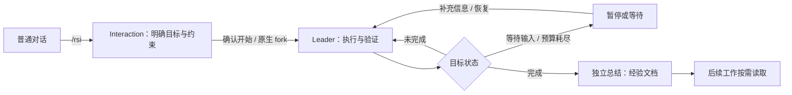

<div align="center">

# AReaL-RSI

**从持续执行目标，到积累可复用的研究经验。**

[论文](https://arxiv.org/abs/2610.18083) · [快速开始](#快速开始) · [使用指南](docs/usage.md) · [研究示例](#研究示例) · [AReaL](https://github.com/areal-project/AReaL)

</div>

AReaL-RSI 是面向持续研究与迭代改进的 Agent 框架。你可以先讨论问题，再将对话中的目标、
约束和完成标准交给 Agent 持续执行；任务结束后，将有依据的方法沉淀为后续工作可读取的经验。

我们关注的是：**在相同时间内取得更好的结果，或用更少时间达到同一目标。**
目标续行、经验复用和实验记录服务于这个目标；任务是否完成，应由交付结果和验证证据说明。

当前实现以原生 Codex app-server 为执行内核，提供单 Agent 工作流、终端交互与可复用的研究基础设施。
[AReaL](https://github.com/areal-project/AReaL) 提供模型训练能力；AReaL-RSI 组织研究过程，
具体任务通过独立 example 调用这些能力。

> **关于论文与当前版本**：论文
> [AReaL-RSI: Adaptive Scaling and Coordination of Recursive Self-Improvement](https://arxiv.org/abs/2610.18083)
> 研究持久研究团队、条件化经验共享与跨轮次演化。当前代码采用精简的单 Agent 内核，
> 尚未接入论文中的多研究员协同机制；本文档描述当前实现，论文实验结果请以论文中的版本和设置为准。

## 核心能力

- **围绕目标持续执行。** 从普通对话切入需求讨论，明确目标后交接执行；回合结束而目标仍未完成时，宿主继续推进。支持补充指令、暂停、恢复与预算控制。
- **沿用原生上下文。** 讨论阶段使用同一会话，执行阶段通过原生 fork 继承历史，包括消息、工具结果与压缩记录。
- **积累可编辑的经验。** 独立总结会话提炼方法，每个主题保存为一份 Markdown；后续工作按需读取。支持自动总结与人工复盘反馈。
- **记录可核查的实验过程。** 公共基础设施提供子进程生命周期、评测完整性检查、轨迹存储、源码与产物摘要，以及 AReaL checkpoint 校验。
- **任务策略独立于内核。** 数据合成、候选选择、训练课程和验收协议由 example 定义；通用 API、基础设施和 CLI 不依赖 examples。

## 快速开始

### 1. 安装

需要 Python **3.11+**、[uv](https://docs.astral.sh/uv/)、Node.js **22+**、npm、系统 `patch`，
以及 Codex CLI **0.162.1+**。当前原生协议测试使用 Codex CLI 0.162.1。
普通对话和目标执行不需要本地 GPU。

```bash
git clone https://github.com/areal-project/AReaL-RSI.git
cd AReaL-RSI

npm install -g @openai/codex@0.162.1
uv tool install --editable .
```

安装后可直接使用 `areal-rsi`。若终端找不到命令，执行 `uv tool update-shell` 后重新打开终端。
可编辑安装会使用当前 checkout 中的 Python 源码，修改代码后无需重新安装。

### 2. 配置模型

复制配置模板；已有 `.env` 时保留原文件：

```bash
cp -n .env.example .env
```

在 `.env` 中设置模型连接：

```dotenv
RSI_BASE_URL=https://api.openai.com/v1
RSI_API_KEY=your-api-key
RSI_MODEL=your-model-name
```

模型服务须支持 Responses API 和工具调用；图片任务还需要图片输入支持。
运行时加载**启动目录**中的 `.env`，也可通过 `--env-file` 指定。
RSI 使用独立的 Codex 配置和会话目录，不改写日常 Codex 的登录或配置。

> 默认权限为 `danger-full-access` / `never`：执行不弹审批，工作目录不是文件访问边界。
> 如需限制，在 `.env` 中调整 `RSI_SANDBOX` 和 `RSI_APPROVAL_POLICY`；恢复旧会话时沿用其已保存权限。

### 3. 开始工作

```bash
areal-rsi
```

首次启动会安装锁定的 TUI 依赖并应用编辑器补丁，需要联网。
随后可以直接对话，或指定一个工作区：

```bash
areal-rsi --workspace /absolute/path/to/project
```

在终端中输入目标，例如：

```text
/rsi 优化这个项目的数据加载性能。先测量基线，保持输出一致，
只修改数据加载模块，完成后报告测试结果与耗时对比。
```

Agent 会先讨论目标与约束。明确要求开始后，执行角色接手工作；任务保存后也可输入 `/start`。

## 工作流程



Interaction 与 Leader 是同一执行内核中的不同角色阶段。当前 Leader 是唯一执行者，
完成证据由它提交、宿主检查结构；通用会话尚无独立验证器替代实际的质量验收。
任务也可以只改进代码或 harness，训练并非必选步骤。

| 操作 | TUI 命令 |
| --- | --- |
| 进入目标讨论 / 开始执行 | `/rsi [目标]` / `/start` |
| 执行中补充要求 | 直接发送消息 |
| 暂停 / 恢复 / 停止 | `/pause` / `/resume` / `/stop` |
| 查看目标与预算 | `/status` / `/budget` |
| 设置 token 与活跃执行秒数上限 | `/budget 100000 3600` |
| 关闭预算限制 | `/budget off` |
| 总结经验 / 查看经验文档 | `/learn [复盘反馈]` / `/docs` |
| 等待人工复盘后再总结 | `/learn-mode guided` |
| 历史会话 / 恢复会话 | `/sessions` / `/open run-ID` |
| 回到普通对话 / 保存退出 | `/chat` / Ctrl+Q |

新目标默认不设置 token 或时间上限。退出会暂停未完成工作，重新打开后需显式恢复。
宿主运行于当前进程，关闭终端、关机等仍会中断执行；长会话遵循 Codex 的上下文压缩机制。
图片、模型切换、权限、经验更新和恢复语义见 [完整使用指南](docs/usage.md)。

非交互使用：

```bash
areal-rsi doctor                         # 检查原生协议，不调用模型
areal-rsi run '检查项目并总结结构'         # 执行并输出 JSON 事件
areal-rsi run --resume run-ID '继续检查'
areal-rsi learn --resume run-ID '复盘这次工作的验证方法'
```

`run` 的退出码：`0` 完成，`1` 失败，`2` 需要交互、暂停或预算停止。

## 研究示例

Example 拥有自己的入口和实验协议，通过公共 API / infra 组织研究。
**`areal-rsi` 只提供通用会话命令，不注册任务专用子命令。**

| 示例 | 研究内容 | 运行与结果 |
| --- | --- | --- |
| TIR 最小训练闭环 | 合成数据 → 基线 → GRPO → checkpoint → 复评 | [运行说明](examples/tir/README.md) · [GPU 闭环记录](docs/tir-validation.md) |
| ToRL 多轮研究 | 基于 train/valid 研发数据策略与训练配方，冻结选择后独立 test | [研究协议与启动](examples/tir/RESEARCH.md) · [实验结果](examples/tir/RESULTS.md) |

TIR 多轮研究需要 Slurm、Apptainer、AReaL 源码与训练环境，以及可访问的模型和数据。
在集群上配置 `examples/tir/experiment.json` 和 `.env` 后，从仓库根目录启动：

```bash
uv sync --locked
source .venv/bin/activate
python -m examples.tir.rsi
```

该入口准备实验、执行 valid 基线并启动多轮研究。首次准备 ToRL parquet、恢复中断及最终 test
验收的方法见 [研究说明](examples/tir/RESEARCH.md#运行)。GPU 依赖保留在独立 AReaL 环境中。

仓库记录了一次 Qwen2.5-Math-1.5B 四轮研究：选定候选在 ToRL 官方 test 的原生 MathVerify
逐行准确率由 **20.86% 提升至 28.07%**。这是单训练种子、固定 harness 下的实验记录，
覆盖 194 道独立题、374 个采样行；不是当前入口的通用收益保证。完整设置、区间、失败轮次及
证据存放位置见 [结果报告](examples/tir/RESULTS.md)。实验大文件未包含在 Git 仓库中。

## 架构与扩展

```text
src/areal_rsi/
├── api/       数据契约、协议与控制请求
├── infra/     ResearchSystem、目标调度、经验、执行、训练与评测
└── ui/        CLI 与终端交互
examples/
└── tir/       TIR 数据、研究策略、实验协议与独立入口
```

依赖方向：**UI / examples → infra → api**。API 不导入实现，infra 不导入 UI，
整个通用包不导入 examples。系统入口是
[`ResearchSystem`](src/areal_rsi/infra/research.py)。

新增任务时，在独立 example 中定义数据、可修改范围、实验流程与验收方式，复用公共执行、
评测和训练服务。只有出现真实复用需求时，才将任务无关能力提炼到 infra。
详细接口与当前实现范围见 [API 文档](docs/interfaces/README.md)。

## 文档

| 文档 | 内容 |
| --- | --- |
| [使用指南](docs/usage.md) | TUI 操作、模型配置、预算、权限与经验管理 |
| [架构与上下文](docs/architecture.md) | 角色交接、目标调度、持久化与恢复 |
| [API 与契约](docs/interfaces/README.md) | 公共接口及已实现 / 预留能力 |
| [代码导读](docs/walkthrough.md) | 从入口到执行内核的阅读路线 |
| [测试说明](tests/README.md) | 离线测试、原生协议测试与真实 API 实验 |
| [经验实验](docs/experience-study.md) | 经验提炼与复用的实验方法和记录 |
| [TUI 来源](docs/tui-comparison.md) | DSH 组件选型、复用与补丁 |

## 开发与贡献

欢迎通过 issue 或 PR 贡献故障复现、测试、任务示例和公共能力改进。
开始前请阅读 [开发约束](AGENTS.md)，保持任务策略与通用内核的边界。

```bash
uv sync --locked
make check
```

`make check` 包含 Python 测试、原生 TUI 测试、Ruff 和严格 Mypy。
原生集成测试需要 Node.js 与支持版本的 Codex，模型端使用本地 fixture；真实模型 API 和 GPU
训练不属于默认测试集。提交实验结果时，请同时说明配置、预算、基线及可核查证据。

## 论文引用

如果 AReaL-RSI 的研究思路对你的工作有帮助，请引用：

```bibtex
@article{zhou2026arealrsi,
  title   = {{AReaL-RSI}: Adaptive Scaling and Coordination of Recursive Self-Improvement},
  author  = {Zhou, Wenhao and Song, Jiajun and Wang, Haitao and Qiu, Zipeng and
             Peng, Yingqi and Xu, Ruida and Li, Jiale and Li, Wenshuang and
             Xu, Shusheng and Dong, Wei and Dai, Hao and Yang, Tongkai and
             Gao, Yi and Yuan, Binhang},
  journal = {arXiv preprint arXiv:2610.18083},
  year    = {2026},
  url     = {https://arxiv.org/abs/2610.18083}
}
```

感谢 [AReaL](https://github.com/areal-project/AReaL) 的训练基础设施、
[Codex](https://github.com/openai/codex) 的执行内核，以及
[DSH 组件](docs/tui-comparison.md) 提供的终端交互能力。
