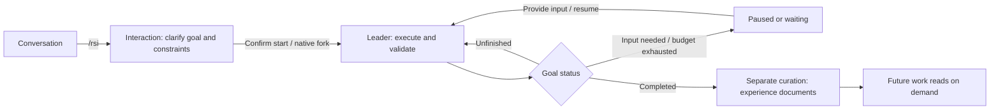

<div align="center">

# AReaL-RSI

**Pursue persistent goals. Build reusable research experience.**

[Paper](https://arxiv.org/abs/2610.18083) · [Getting Started](#getting-started) · [User Guide](docs/usage.md) · [Research Examples](#research-examples) · [AReaL](https://github.com/areal-project/AReaL)

</div>

AReaL-RSI is an agent framework for sustained research and iterative improvement. Start with a
conversation, establish a goal with constraints and acceptance criteria, and let the agent work
toward it across turns. Afterward, distill evidence-backed methods into experience that future
work can reuse.

Our objective is **better results within the same time budget, or less time to reach the same
result**. Goal continuation, experience reuse, and experiment records serve that objective;
deliverables and validation evidence determine whether the work is complete.

The current implementation uses the native Codex app-server as its execution runtime, with a
single-agent workflow, a terminal interface, and reusable research infrastructure.
[AReaL](https://github.com/areal-project/AReaL) provides model training capabilities;
AReaL-RSI organizes the research process. Independent examples combine these capabilities for
specific tasks.

> **Paper and implementation scope.**
> [AReaL-RSI: Adaptive Scaling and Coordination of Recursive Self-Improvement](https://arxiv.org/abs/2610.18083)
> studies persistent research teams, conditional experience sharing, and evolution across campaigns.
> This checkout uses a streamlined single-agent core and does not yet integrate the paper's
> multi-researcher coordination mechanisms. This README describes the current implementation;
> refer to the paper for its experimental versions, settings, and results.

## Highlights

- **Persistent goal execution.** Move from conversation to goal clarification and execution. The host continues unfinished goals across turns, with support for steering, pausing, resuming, and budget controls.
- **Native context continuity.** Discussion stays in the same session; execution inherits history through a native fork, including messages, tool results, and compaction records.
- **Editable research experience.** A separate curation session distills methods into one Markdown document per topic. Future work reads relevant documents on demand. Both automatic curation and human review feedback are supported.
- **Auditable experiments.** Shared infrastructure manages subprocess lifecycles, evaluation completeness, trajectory storage, source and artifact digests, and AReaL checkpoint validation.
- **Task policies outside the core.** Examples define data synthesis, candidate selection, training curricula, and acceptance protocols. The general-purpose API, infrastructure, and CLI do not depend on examples.

## Getting Started

### 1. Install

Requirements: Python **3.11+**, [uv](https://docs.astral.sh/uv/), Node.js **22+**, npm,
the system `patch` utility, and Codex CLI **0.162.1+**. Native protocol tests currently use
Codex CLI 0.162.1. Ordinary conversations and goal execution do not require a local GPU.

```bash
git clone https://github.com/areal-project/AReaL-RSI.git
cd AReaL-RSI

npm install -g @openai/codex@0.162.1
uv tool install --editable .
```

You can now invoke `areal-rsi` directly. If your shell cannot find it, run `uv tool update-shell`
and open a new terminal. The editable installation uses Python source from this checkout, so
source edits do not require reinstallation.

### 2. Configure a model

Copy the configuration template, preserving any existing `.env`:

```bash
cp -n .env.example .env
```

Set your model connection in `.env`:

```dotenv
RSI_BASE_URL=https://api.openai.com/v1
RSI_API_KEY=your-api-key
RSI_MODEL=your-model-name
```

The model service must support the Responses API and tool calling. Image tasks also require
image input support. The runtime loads `.env` from the **directory where you launch the command**;
use `--env-file` to select another file. RSI maintains separate Codex configuration and session
directories without changing your regular Codex login or configuration.

> Default permissions are `danger-full-access` / `never`: execution does not prompt for approval,
> and the workspace is not a filesystem access boundary. Adjust `RSI_SANDBOX` and
> `RSI_APPROVAL_POLICY` in `.env` if needed. Resumed sessions retain their saved permissions.

### 3. Start working

```bash
areal-rsi
```

The first launch installs locked TUI dependencies and applies editor patches, requiring network
access. Start chatting, or select a workspace:

```bash
areal-rsi --workspace /absolute/path/to/project
```

Enter a goal in the terminal, for example:

```text
/rsi Improve this project's data loading performance. Measure a baseline first,
keep outputs unchanged, modify only the data loading module, and report tests
and timing comparisons when finished.
```

The agent first discusses the goal and constraints. Once you explicitly ask it to begin, the
execution role takes over. You can also enter `/start` after the task has been saved.

## Workflow



Interaction and Leader are role stages within the same execution runtime. The current Leader
is the sole executor: it supplies completion evidence, and the host validates its structure.
General-purpose sessions do not yet have an independent verifier to assess result quality.
Tasks can improve code or a harness without any model training.

| Action | TUI command |
| --- | --- |
| Discuss a goal / start execution | `/rsi [goal]` / `/start` |
| Steer ongoing work | Send a message directly |
| Pause / resume / stop | `/pause` / `/resume` / `/stop` |
| Inspect goal and budget | `/status` / `/budget` |
| Set token and active execution time limits in seconds | `/budget 100000 3600` |
| Remove budget limits | `/budget off` |
| Curate experience / browse documents | `/learn [review feedback]` / `/docs` |
| Wait for human feedback before curation | `/learn-mode guided` |
| List sessions / reopen a session | `/sessions` / `/open run-ID` |
| Return to conversation / save and exit | `/chat` / Ctrl+Q |

New goals have no token or time limit by default. Exiting pauses unfinished work; reopening a
session requires explicit resumption. The host runs in the current process, so closing the
terminal or shutting down still interrupts execution. Long sessions use Codex's native context
compaction. See the [user guide](docs/usage.md) for images, model switching, permissions,
experience updates, and recovery behavior.

For non-interactive use:

```bash
areal-rsi doctor                         # Check the native protocol without a model call
areal-rsi run 'Inspect and summarize the project'  # Emit JSON events
areal-rsi run --resume run-ID 'Continue the inspection'
areal-rsi learn --resume run-ID 'Review the validation methods used in this task'
```

Exit codes for `run`: `0` for completion, `1` for failure, and `2` when interaction is needed,
execution is paused, or a budget limit is reached.

## Research Examples

Examples own their entry points and experimental protocols, using the public API and
infrastructure to organize research. **`areal-rsi` provides general-purpose session commands;
it does not register task-specific subcommands.**

| Example | Research scope | Guides and results |
| --- | --- | --- |
| Minimal TIR training loop | Synthetic data → baseline → GRPO → checkpoint → reevaluation | [Run guide](examples/tir/README.md) · [GPU validation record](docs/tir-validation.md) |
| Multi-round ToRL research | Develop data strategies and training recipes on train/valid, freeze selection, then evaluate independently on test | [Protocol and setup](examples/tir/RESEARCH.md) · [Results](examples/tir/RESULTS.md) |

Multi-round TIR research requires Slurm, Apptainer, an AReaL source checkout and training
environment, and accessible model and data files. Configure `examples/tir/experiment.json`
and `.env` on the cluster, then launch from the repository root:

```bash
uv sync --locked
source .venv/bin/activate
python -m examples.tir.rsi
```

This entry point prepares the experiment, evaluates the validation baseline, and starts
multi-round research. See the [research guide](examples/tir/RESEARCH.md#运行) for initial ToRL
Parquet preparation, recovery, and final test evaluation. GPU dependencies stay in a separate
AReaL environment.

The repository records a four-round study with Qwen2.5-Math-1.5B: the selected candidate's
per-row accuracy under native MathVerify on the official ToRL test set increased from
**20.86% to 28.07%**. This is a single-training-seed experiment with a fixed harness, covering
194 independent questions and 374 sampling rows, not a general performance guarantee for
this entry point. See the [results report](examples/tir/RESULTS.md) for settings, confidence
intervals, unsuccessful rounds, and evidence locations. Large experiment artifacts are not
included in the Git repository.

## Architecture and Extension

```text
src/areal_rsi/
├── api/       Data contracts, protocols, and control requests
├── infra/     ResearchSystem, goal scheduling, experience, execution, training, evaluation
└── ui/        CLI and terminal interface
examples/
└── tir/       TIR data, research policies, protocols, and independent entry points
```

Dependencies flow **UI / examples → infra → api**. The API does not import implementations,
infra does not import UI, and the general-purpose package does not import examples.
The system entry point is [`ResearchSystem`](src/areal_rsi/infra/research.py).

To add a task, define its data, editable scope, experimental workflow, and acceptance procedure
in an independent example. Reuse the shared execution, evaluation, and training services.
Extract task-independent capabilities into infra only when there is a concrete reuse need.
See the [API documentation](docs/interfaces/README.md) for interfaces and implementation scope.

## Documentation

The detailed guides below are currently in Chinese.

| Document | Contents |
| --- | --- |
| [User guide](docs/usage.md) | TUI operations, model configuration, budgets, permissions, and experience management |
| [Architecture and context](docs/architecture.md) | Role handoff, goal scheduling, persistence, and recovery |
| [API and contracts](docs/interfaces/README.md) | Public interfaces, implemented capabilities, and reserved contracts |
| [Code walkthrough](docs/walkthrough.md) | A reading path from entry points to the execution core |
| [Testing](tests/README.md) | Offline tests, native protocol tests, and real API experiments |
| [Experience study](docs/experience-study.md) | Methods and records for experience curation and reuse |
| [TUI provenance](docs/tui-comparison.md) | DSH component selection, reuse, and patches |

## Development and Contributing

Contributions through issues and pull requests are welcome, including reproductions, tests,
task examples, and improvements to shared capabilities. Read the
[development guidelines](AGENTS.md) first and preserve the boundary between task policies
and the general-purpose core.

```bash
uv sync --locked
make check
```

`make check` runs Python tests, native TUI tests, Ruff, and strict Mypy checks.
Native integration tests require Node.js and a supported Codex version, with a local fixture
serving as the model endpoint. Real model API calls and GPU training are outside the default
test suite. When reporting experimental results, include configuration, budgets, baselines,
and auditable evidence.

## Citation

If AReaL-RSI's research ideas are useful to your work, please cite:

```bibtex
@article{zhou2026arealrsi,
  title   = {{AReaL-RSI}: Adaptive Scaling and Coordination of Recursive Self-Improvement},
  author  = {Zhou, Wenhao and Song, Jiajun and Wang, Haitao and Qiu, Zipeng and
             Peng, Yingqi and Xu, Ruida and Li, Jiale and Li, Wenshuang and
             Xu, Shusheng and Dong, Wei and Dai, Hao and Yang, Tongkai and
             Gao, Yi and Yuan, Binhang},
  journal = {arXiv preprint arXiv:2610.18083},
  year    = {2026},
  url     = {https://arxiv.org/abs/2610.18083}
}
```

We thank [AReaL](https://github.com/areal-project/AReaL) for its training infrastructure,
[Codex](https://github.com/openai/codex) for its execution runtime, and
[DSH](docs/tui-comparison.md) for the terminal components.
