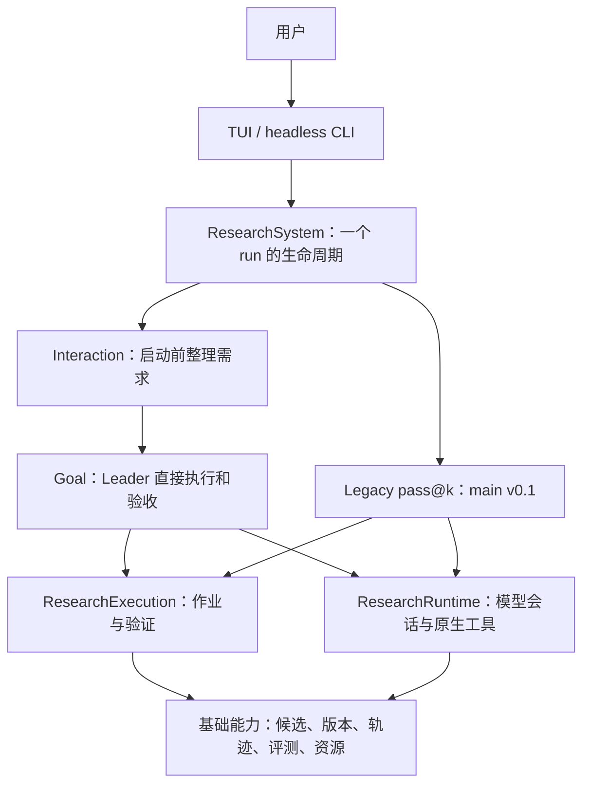

# 架构与演进边界

设计依据：[RSI Design Doc](https://yuque.antfin.com/areal-team/swe/ot9ck3wxptzz4zdh)。本分支保留文档中的基础能力分层，调整 Evolver 的职责：默认 Leader 执行完整任务，未来 Researcher 执行 Leader 分配的局部任务。准出针对一个 run。

## 当前职责

- `api/research.py`：任务、goal、候选、验证、消息和调度状态。`TeamTask` / `TaskReport` 是未来分工契约。
- `api/interfaces.py`：Runtime、VersionManager、TrajectoryStore、Memory、Builder、TrainingBackend 等能力协议，以及未实现的 `AgentTeam`。
- `infra/research.py`：create/start/message/pause/resume/stop/export、进程所有权与资源释放。无 HTTP dispatcher。
- `infra/coordination/coordinator.py`：持久状态与消息交付；`engine.py`：模型回合调度、恢复、使用量、取消和预算。
- `infra/coordination/policies/goal.py`：Leader 持续执行、阻塞、完成判定。`legacy_passk.py`：独立完整尝试的历史行为。
- `infra/coordination/tools/`：角色权限、工作区、候选和证据工具；`evaluation/`：受管理作业及可信验证。
- `infra/runtime/`：DSH、Codex 和 Runtime 包接入、会话、沙箱和工具桥。
- `infra/storage/`、`infra/tasks/`、`infra/execution/`：内容快照、追加版本、轨迹、Task 执行、评测和资源生命周期。
- `ui/tui.py`、`ui/cli.py`：展示与输入，不包含研究策略。

`ResearchSystem.attach()` 只组装或复用本地运行实例，后台执行由 `_serve()` 管理。
模型、作业监控和 run 所有权在创建时登记到资源栈，初始化失败、后台退出或提前取消都使用同一套释放逻辑。
模型调度循环退出后关闭模型会话；作业监控和 run 锁保留至 legacy 最终复测结束。
两种 Engine 各自提供默认 prompt，legacy 的达标停止、预算停止和最终复测规则集中在 `legacy_passk.py`。

## Goal 流程

Interaction 可以跳过：完整配置直接 `start`。对话创建时，Interaction 将需求保存为 brief，然后 `start_research`。启动后 Interaction 不再参与执行，用户消息直接投递给 Leader。

Leader 使用自己的工作区、原生文件/终端工具、候选与作业工具执行任务。`update_goal` 持久化摘要、当前步骤、下一步、验收条件、证据和阻塞原因。回合结束而 goal 仍 active 时，调度器在原会话继续。`ask_user` / blocked 停止续跑，用户回答后恢复；等待作业通过持久 waiter 唤醒，不靠模型循环查询。

`completed` 需要明确的验收条件和证据，不允许跳过未完成作业或未处理的用户消息。有正式协议时检查候选、协议摘要、阶段、目标分数和最新验证结果；要求 final 时必须对同一候选完成 final。没有 verifier 时保存 Leader 的验收依据，可信度来自实际工具证据和 Leader 判断，不宣称系统能自动证明任意自然语言要求。

候选是不可变快照。`/export` 只导出验收时选定的快照，工作区之后的修改不会混入。Git worktree 与用户原检出隔离。完成一个 run 不意味着自动发布、合并或部署。

暂停与等待不等于完成。关闭 TUI 中断本地模型执行，但保留活动消息、会话和作业供重启；stop 取消未完成作业，终止 run。预算耗尽保存未完成状态。正式验证失败时 Leader 可以继续修复。

## 未来 Agent Team（仅契约）

参考 [DeepSeek Harness Agent Team](https://github.com/deepseek-ai/deepseek-harness/tree/master/packages/experimental/tool-agent-team) 的 Leader 派发和持久任务思想。保留现有 Runtime、作业、记录机制，不接入另一套模型循环。

1. Leader 拆分 `TeamTask`：run、任务说明、局部验收条件和授予的输入引用。
2. Leader 通过 `AgentTeam.delegate` 启动 Researcher。Researcher 使用独立会话/worktree，仅获取任务及授权材料。
3. Researcher 返回 `TaskReport`：结果、候选、证据或阻塞；完成任务不会完成 run。
4. Leader 检查报告、整合产物、解决冲突并验证，继续用当前 run 完成入口准出。Leader 也可以自己执行任意步骤。

当前没有 Team 的 spawn 工具、task board 调度、同伴通信或集成实现，也不接受 `agent_team` 配置值。将来实现时不复用 legacy 中“每人完整解题”的启动语义。训练后端等尚未接入能力保持协议，不提供返回假成功的占位实现；底层已有 Task HarnessRuntime 承担推理执行。

## 不兼容范围

只接受 `goal` 和 `legacy_passk`。删除协作模块组合、v0.2.x/leader guidance、旧 Researcher goal、Web/UI 控制协议及个人历史实验配置。新状态使用具名记录并严格校验，不为旧数据加入迁移分支。源代码清理不修改用户仓库、共享数据集或外部实验服务。
