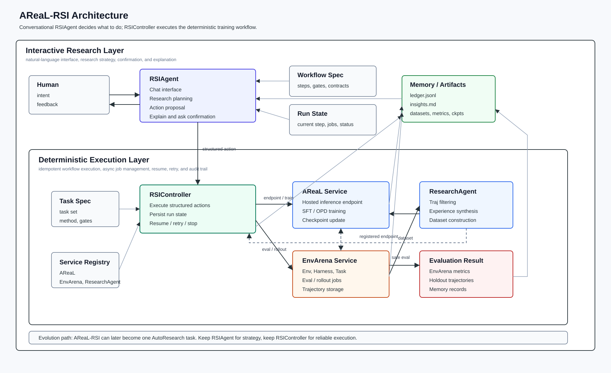

# AReaL-RSI Design

## 1. 项目简介
AReaL-RSI 是一个基于 AReaL 和 EnvArena 的自动研究与训练闭环。它把环境评测产生的轨迹转成可复用的 experience 和训练数据，再通过 AReaL 执行 SFT / OPD 训练，并用后续评测结果决定是否进入下一轮。

核心闭环：

```text
holdout eval current ckpt
  -> training-benchmark traj
  -> ResearchAgent synthesizes task Experience
  -> EnvArena evaluates model + Experience Skill
  -> original prompt + skill-assisted completion
  -> AReaL SFT without Experience in the prompt
  -> next ckpt
```

设计上不把所有事情都交给自然语言 Agent 自由发挥。`RSIAgent` 负责对话、解释和策略决策；`RSIController` 负责确定性执行、状态持久化和任务恢复。

## 2. 架构图


## 3. 设计原则
### 3.1 Agent 决定 What / Why
`RSIAgent` 负责理解用户意图，并决定这一轮研究要做什么、为什么做：

+ 解释当前 run 状态。
+ 根据 Memory 和评测结果提出下一轮计划。
+ 选择 task set、traj filter、训练方法和 eval gate。
+ 将自然语言请求转成结构化 action。
+ 在启动 loop、停止 run 等关键节点请求用户确认。

### 3.2 Controller 决定 How / When
`RSIController` 负责执行固定、可恢复的 workflow：

+ 注册或更新 AReaL inference endpoint。
+ 调 EnvArena 提交 eval / rollout job。
+ poll job 状态并拉取 traj。
+ 调 ResearchAgent 生成 dataset。
+ 调 AReaL 执行 SFT / OPD。
+ 写入 Memory / artifacts。
+ 支持 resume、retry、stop 和 status 查询。

### 3.3 自然语言只产生计划，不直接替代执行协议
用户可以用自然语言表达目标和约束，例如“用 ckpt_000 在 swe_verified 上最多跑 3 轮，提升小于 1% 就停”。系统内部应先转成结构化 user command，再由 Controller 执行。

```json
{
  "type": "start_loop",
  "args": {
    "goal": "Improve ckpt_000 on swe_verified.",
    "initial_ckpt": "ckpt_000",
    "task_set": "swe_verified",
    "max_iterations": 3,
    "stop_criteria": {
      "min_delta": 0.01
    }
  }
}
```

这样可以保留对话灵活性，同时避免重复提交 job、丢失状态、漏写 artifact 或无法恢复。

## 4. 模块设计
### 4.1 RSIAgent
`RSIAgent` 是人机交互入口和 research 决策层。它不直接管理长任务状态，也不直接实现训练流程。

输入：

+ 用户自然语言。
+ Workflow spec。
+ Controller run state。
+ Memory context。
+ Eval / train / dataset artifacts 摘要。

输出：

+ 给用户的解释。
+ 下一步建议。
+ 结构化 action。
+ 是否需要用户确认。

典型能力：

+ `chat`：对话式入口。
+ `propose_next_action`：根据当前状态提出下一步。
+ `explain`：解释某轮为什么选择这些 traj、experience、method 或 ckpt。
+ `revise_plan`：根据用户反馈修改 task set、traj filter、训练配置或 eval gate。

### 4.2 RSIController
`RSIController` 是 workflow executor。它只做编排和状态管理，不承载复杂研究策略。

它维护 run state：

```json
{
  "run_id": "rsi_run_003",
  "iteration": 3,
  "current_step": "collect_trajs",
  "status": "running",
  "ckpt": "ckpt_000",
  "eval_job_id": "eval_839",
  "completed_steps": [
    "ensure_rollout_endpoint",
    "register_model",
    "submit_eval"
  ],
  "pending_steps": [
    "collect_trajs",
    "generate_dataset",
    "train",
    "holdout_eval"
  ]
}
```

Controller 是事实来源。用户问“现在跑到哪了”这类简短状态问题时，
`RSIAgent` 应基于当前 `run_state` 和 Memory 上下文直接回答；只有用户明确要
查看完整 state / metadata / 运行详情时，才触发 `inspect_run` action。

### 4.3 AReaL
#### Rollout Service
AReaL 负责托管模型推理服务，EnvArena 不需要自己拉起模型服务。

AReaL Rollout Service 提供：

+ 推理服务，例如 SGLang / AReaL proxy。
+ Remote proxy agent，远端 agent 代理，实际运行在 EnvArena。
+ ckpt 更新后的 endpoint 更新或重新注册。

它对 EnvArena 暴露的是一个注册后的模型 endpoint：

```json
{
  "model_ref": "ckpt_001",
  "base_url": "http://areal-inference-service/v1",
  "api_key": "session-or-service-key"
}
```

EnvArena Harness 在任务执行过程中调用这个 endpoint 获取模型输出。

#### Train Service
Train Service 负责执行训练链路，并产出 ckpt。

| Method | 含义 | 是否依赖 EnvArena |
| --- | --- | --- |
| `sft` | 使用 ResearchAgent 生成的 Task + Experience 数据训练 | 间接依赖，数据来自 EnvArena Traj |
| `opd` | on-policy distill，基于当前模型或 teacher 在 EnvArena 上跑出的新轨迹蒸馏 | 直接依赖，需要调用 EnvArena 采集 on-policy traj |

### 4.4 EnvArena
EnvArena 提供 Env、Harness、Task 和 human-in-the-loop 评测过程。它负责执行任务、调用已注册模型、记录完整交互，并提供查询接口。

EnvArena 对外暴露的核心能力：

+ 注册、更新、删除模型 endpoint。
+ 提交评测任务。
+ 提交 rollout 任务。
+ 查询任务进度。
+ 获取某个任务产出的轨迹列表。
+ 获取单条轨迹的详细步骤。

Traj API：

```json
{
  "traj_id": "traj_001",
  "task_id": "task_001",
  "model_ref": "ckpt_000",
  "harness_id": "swe_harness",
  "reward": 0.0,
  "status": "done",
  "metadata": {
    "source": "eval",
    "eval_job_id": "eval_001"
  },
  "messages": [
    {
      "role": "system"
    }
  ]
}
```

### 4.5 ResearchAgent
ResearchAgent 是一个面向轨迹和数据生成的 worker agent。它由 `Model Service + Research Harness` 组成，读取 EnvArena 的轨迹和 Memory 中的历史上下文，筛选合适任务，总结 Experience，并构造训练数据集。

ResearchAgent 内部可以是一个 loop：

```text
读取 Trajs
  -> 过滤无效或低价值轨迹
  -> 按 Task 聚合多条 Traj
  -> 总结 Experience
  -> 可选：调用 EnvArena 验证 model + experience 的效果
  -> 记录 research attempt 到 Memory
  -> 构造 Dataset
```

第一版 ResearchAgent 对外只暴露粗粒度接口：`generate_dataset(...)`。内部的 task selection、experience summarization、teacher eval 暂时不拆成公开接口，但要写入 Memory 便于审计。

### 4.6 Memory / Artifacts
Memory 是 AReaL-RSI 迭代过程中的全局事件和产物记录系统。

第一版可以保留 Markdown/event 记录；建议同时写结构化 ledger：

+ `ledger.jsonl`：机器可读，记录每轮 action、dataset、train run、eval result、decision。
+ `insights.md`：ResearchAgent 可读，沉淀可复用经验、失败模式和下一轮建议。
+ artifacts：保存 dataset、train config、metrics、ckpt ref、eval reports。

记录内容：

+ ResearchAgent 尝试过程：traj 选择、experience 生成、teacher 验证、输出 dataset。
+ Trainer 训练过程：dataset、训练配置、训练指标、ckpt。
+ Eval 过程：task set、metrics、失败类型、是否接受 ckpt。
+ Human feedback：用户对筛选策略、训练方法、ckpt 选择的干预。

## 5. 整体训练过程
### 5.1 对话驱动入口
用户通过 `RSIAgent` 发起或调整任务：

```text
User: 用 ckpt_000 在 swe_verified 上跑一轮，先用 sft。

RSIAgent:
  我会启动一轮 RSI：先在 holdout 上评测当前 checkpoint；未达到目标时，
  再从训练集轨迹生成 Experience Skill，蒸馏带提示轨迹并执行无提示 SFT。
  是否开始？
```

Agent 生成结构化 action：

```json
{
  "type": "start_loop",
  "requires_confirmation": true,
  "args": {
    "goal": "Improve ckpt_000 on swe_verified.",
    "initial_ckpt": "ckpt_000",
    "task_set": "swe_verified",
    "method": "sft",
    "max_iterations": 3,
    "harness_config": {
      "harness": "default"
    }
  }
}
```

用户确认后，`RSIAgent` 调用 `RSIController.execute_action(action)`。

### 5.2 Controller 执行闭环
整体训练过程按外层 RSI iteration 推进：

1. Controller 在 holdout benchmark 上评测当前 `ckpt_k`。
2. 如果 holdout 分数已经达到用户目标，当前 iteration 不执行 research 和训练，Run 直接成功结束。
3. 未达到目标时，Controller 在训练 benchmark 上进行一次不带 Skill 的评测并拉取完整轨迹。
4. Controller 按 Task 聚合轨迹；ResearchAgent 为每个 Task 生成一条可直接追加到 user prompt 的 Experience。
5. Controller 将这些 Experience 组装成 task-scoped Arena Skill，再次在同一训练 benchmark 上评测当前模型。
6. EnvArena 根据 task_id 把对应 Experience 追加到 user prompt，产生 skill-assisted trajectories。
7. ResearchAgent 只从这些蒸馏轨迹中选择训练目标：原始轨迹提供 system/user prompt，skill-assisted trajectory 提供 assistant/tool completion。
8. 最终 SFT JSONL 中不得包含 Experience，训练时的 prompt 与原训练任务一致，从而把 Experience 蒸馏进模型参数。
9. ResearchAgent 同时基于模板生成完整 AReaL 训练 YAML，Trainer 产出 `ckpt_{k+1}`。
10. iteration 结束时不再进行 holdout eval；如果还有下一轮，ResearchAgent 选择其起始 checkpoint，并在下一轮开始时评测。
11. 最大轮数耗尽则结束 Run；当前最后一个 checkpoint 尚未额外做尾部评测。

## 6. Python 接口
接口只保留模块之间的边界，第一版实现时所有对象都可以先用 `dict[str, Any]` 承载，不先抽复杂 dataclass。

### 6.1 核心对象

```python
from typing import Any, Literal

TrainMethod = Literal["sft", "opd"]
TrajSource = Literal["eval", "research_validation", "opd"]
ActionType = Literal[
    "start_loop",
    "inspect_run",
    "resume_run",
    "stop_run",
]

Endpoint = dict[str, Any]       # AReaL endpoint: model_ref/base_url/api_key/protocol/metadata
ModelRef = dict[str, Any]       # EnvArena registered model: env_model_id/model_ref/metadata
EvalJob = dict[str, Any]        # EnvArena job: eval_job_id/status/metrics/metadata
Traj = dict[str, Any]           # EnvArena trajectory schema
Dataset = dict[str, Any]        # {dataset_id, examples: [{task, experience, source_traj_ids, ...}]}
TrainRun = dict[str, Any]       # {train_run_id, method, ckpt, metrics, metadata}
MemoryContext = dict[str, Any]
RunState = dict[str, Any]
Action = dict[str, Any]         # {type, args, requires_confirmation, metadata}
AgentResponse = dict[str, Any]  # {reply, actions, requires_confirmation}
```

### 6.2 RSIAgent

```python
class RSIAgent:
    def chat(
        self,
        message: str,
        *,
        run_id: str | None = None,
        controller: "RSIController",
        memory: "Memory",
        workflow_spec: dict[str, Any],
    ) -> AgentResponse:
        """对话入口：读取 workflow spec、run state、memory，返回解释和结构化 actions。"""

    def propose_next_action(
        self,
        *,
        run_state: RunState,
        memory_context: MemoryContext,
        workflow_spec: dict[str, Any],
    ) -> Action:
        """根据当前状态提出下一步 action。"""

    def explain(
        self,
        *,
        run_id: str,
        controller: "RSIController",
        memory: "Memory",
        question: str,
    ) -> str:
        """解释某轮选择、训练结果、失败模式或 ckpt 决策。"""
```

### 6.3 RSIController

```python
class RSIController:
    def execute_action(self, action: Action) -> dict[str, Any]:
        """执行 RSIAgent 产出的结构化 action。"""

    def run_iteration(
        self,
        ckpt: str,
        *,
        areal: "AReaLService",
        envarena: "EnvClient",
        research_agent: "ResearchAgent",
        memory: "Memory",
        task_set: str,
        harness_config: dict[str, Any],
        method: TrainMethod = "sft",
        train_config: dict[str, Any] | None = None,
        traj_filter: dict[str, Any] | None = None,
        eval_gate: dict[str, Any] | None = None,
    ) -> RunState:
        """注册模型 -> 评测 -> 生成数据 -> 训练 -> holdout eval -> 写 Memory。"""

    def resume(self, run_id: str) -> RunState:
        """从持久化 state 恢复未完成 workflow。"""

    def stop(self, run_id: str, reason: str | None = None) -> RunState:
        """停止当前 workflow，并记录原因。"""
```

### 6.4 AReaL Service

```python
class AReaLService:
    def ensure_rollout_endpoint(self, ckpt: str, config: dict[str, Any] | None = None) -> Endpoint:
        """启动或复用 AReaL 托管的推理服务。"""

    def update_rollout_endpoint(self, endpoint: Endpoint, ckpt: str) -> Endpoint:
        """训练产出新 ckpt 后，更新推理 endpoint。"""

    def train(
        self,
        base_ckpt: str,
        dataset: Dataset,
        method: TrainMethod,
        config: dict[str, Any],
        *,
        envarena: "EnvClient | None" = None,
        model_ref: ModelRef | None = None,
        harness_config: dict[str, Any] | None = None,
    ) -> TrainRun:
        """执行 SFT 或 OPD；OPD 通过 EnvArena 采集 on-policy traj。"""
```

### 6.5 Environment Client

```python
class EnvClient(Protocol):
    def register_model(self, endpoint: Endpoint) -> ModelRef:
        """注册 AReaL inference endpoint，返回 EnvArena 模型引用。"""

    def update_model(self, model_ref: ModelRef, endpoint: Endpoint) -> ModelRef:
        """AReaL endpoint/ckpt 变化后，更新 EnvArena 注册。"""

    def submit_eval(self, request: EvalRequest) -> EvalJob:
        """提交评测任务。"""

    def get_trajs(self, job: EvalJob, include_messages: bool = False) -> list[Traj]:
        """获取评测产出的轨迹。"""
```

`EnvArenaClient(EnvClient)` is the concrete EnvArena control-plane adapter.
Its registry, Job status/result, and detailed trajectory APIs remain
EnvArena-specific rather than becoming controller requirements.

### 6.6 ResearchAgent

```python
class ResearchAgent:
    def generate_dataset(
        self,
        trajs: list[Traj],
        memory_context: MemoryContext,
        current_ckpt: str,
        *,
        envarena: EnvClient | None = None,
        model_ref: ModelRef | None = None,
        harness_config: dict[str, Any] | None = None,
        traj_filter: dict[str, Any] | None = None,
        config: dict[str, Any] | None = None,
    ) -> Dataset:
        """Traj -> Dataset(Task + Experience)，可选调用 EnvArena 验证 experience。"""

    def choose_ckpt(self, train_runs: list[TrainRun], memory_context: MemoryContext) -> str:
        """可选：结合 Memory 选择下一轮 ckpt；第一版可返回最新 ckpt。"""
```

### 6.7 Memory

```python
class Memory:
    def record(self, title: str, content: str, metadata: dict[str, Any] | None = None) -> str:
        """记录 research/training/eval/human feedback 过程。"""

    def get_context(self, ckpt: str | None = None, run_id: str | None = None, limit: int = 100) -> MemoryContext:
        """返回 RSIAgent 或 ResearchAgent 需要的历史上下文。"""

    def append_ledger(self, event: dict[str, Any]) -> None:
        """写结构化事件，便于恢复、审计和后续分析。"""
```

## 7. 对话示例
### 7.1 启动一轮
```text
User:
用 ckpt_000 在 swe_verified 上跑一轮，先用 sft。

RSIAgent:
我会启动一轮 RSI：注册 AReaL endpoint，提交 EnvArena eval，
拉取轨迹，生成 dataset，执行 SFT，并做 holdout eval。是否开始？
```

Action：

```json
{
  "type": "start_loop",
  "requires_confirmation": true,
  "args": {
    "goal": "Improve ckpt_000 on swe_verified.",
    "initial_ckpt": "ckpt_000",
    "task_set": "swe_verified",
    "method": "sft",
    "max_iterations": 3
  }
}
```

### 7.2 查询进度
```text
User:
现在跑到哪了？

RSIAgent:
当前 run 正在 collect_trajs。AReaL endpoint 已启动，
EnvArena eval job 已提交，已完成 42 / 100 个任务。
下一步会拉取轨迹并交给 ResearchAgent 生成 dataset。
```

### 7.3 调整目标约束
```text
User:
下一次只关注 patch 过大的问题，最多跑 2 轮。

RSIAgent:
我会启动一个新的 RSI loop，把 focus 记录为 patch_scope_control，
并把 max_iterations 设置为 2。内部仍由 ResearchAgent 筛选轨迹和生成数据。
```

Action：

```json
{
  "type": "start_loop",
  "args": {
    "goal": "Reduce oversized patches.",
    "initial_ckpt": "ckpt_001",
    "task_set": "swe_verified",
    "max_iterations": 2,
    "constraints": {
      "focus": "patch_scope_control"
    }
  }
}
```

### 7.4 查看 loop 决策
```text
RSIAgent:
iter_2 之后系统停止了：holdout 提升低于 min_delta=0.01。
最终 ckpt 是 ckpt_002。详细证据见 audit.jsonl 的 loop_decision 事件。

User:
为什么停止？
```

Action：

```json
{
  "type": "inspect_run",
  "args": {
    "run_id": "rsi_run_001"
  }
}
```

## 8. Controller 伪代码

```python
def run_iteration(
    ckpt: str,
    task_set: str,
    method: TrainMethod,
    harness_config: dict[str, Any],
    traj_filter: dict[str, Any] | None = None,
):
    memory.record("iteration_started", f"ckpt={ckpt}, task_set={task_set}, method={method}")

    endpoint = areal.ensure_rollout_endpoint(ckpt, config={"backend": "areal"})
    model_ref = envarena.register_model(endpoint)

    eval_job = envarena.submit_eval(EvalRequest(
        model_ref=model_ref,
        task_set=task_set,
        harness_config=harness_config,
        metadata={"source": "eval"},
    ))
    state.save(step="submit_eval", eval_job=eval_job)

    trajs = envarena.get_trajs(eval_job, include_messages=True)
    state.save(step="collect_trajs", num_trajs=len(trajs))

    dataset = research_agent.generate_dataset(
        trajs=trajs,
        memory_context=memory.get_context(ckpt=ckpt),
        current_ckpt=ckpt,
        envarena=envarena,
        model_ref=model_ref,
        harness_config=harness_config,
        traj_filter=traj_filter,
    )
    memory.record("dataset_created", str(dataset), metadata={"ckpt": ckpt})

    train_run = areal.train(
        base_ckpt=ckpt,
        dataset=dataset,
        method=method,
        config={"epochs": 1},
        envarena=envarena,
        model_ref=model_ref,
        harness_config=harness_config,
    )
    memory.record("train_finished", str(train_run))

    next_ckpt = train_run["ckpt"]
    endpoint = areal.update_rollout_endpoint(endpoint, next_ckpt)
    model_ref = envarena.update_model(model_ref, endpoint)

    holdout_job = envarena.submit_eval(EvalRequest(
        model_ref=model_ref,
        task_set=f"{task_set}_holdout",
        harness_config=harness_config,
        metadata={"source": "holdout_eval"},
    ))
    holdout_trajs = envarena.get_trajs(holdout_job)

    memory.record(
        "ckpt_evaluated",
        str({"ckpt": next_ckpt, "num_trajs": len(holdout_trajs)}),
    )
    state.save(step="finished", ckpt=next_ckpt, status="waiting_for_acceptance")

    return state.current()
```

## 9. 演进到通用 AutoResearch
AReaL-RSI 可以作为通用 AutoResearch 的一个 domain loop，而不是和 AutoResearch 对立。

```text
AutoResearch
  -> AReaL-RSI
  -> dataset search
  -> reward search
  -> workflow search
  -> training recipe search
```

演进方式：

1. 把当前 `run_iteration(...)` 的入参抽成 task spec。
2. 给 AReaL、EnvArena、ResearchAgent 包一层 service adapter。
3. Memory 内部增加 `ledger.jsonl` 和 `insights.md`。
4. 把 `RSIController` 泛化成可执行不同 workflow 的 executor。
5. 保留 `RSIAgent` 作为对话入口和策略层，后续可升级成更通用的 `AutoResearchAgent`。
