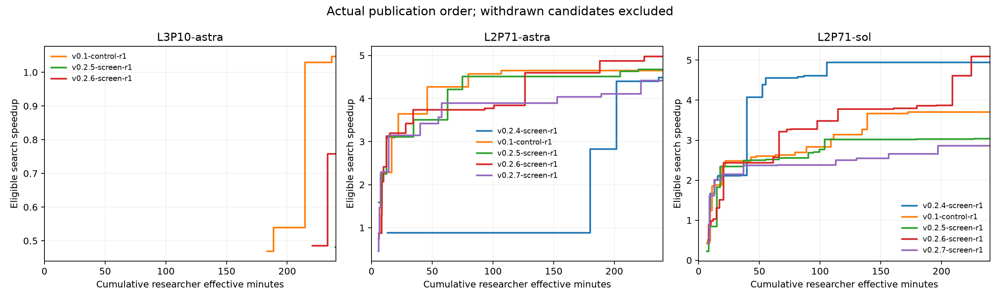

# 9 月 19 日晚 RSI 协作实验报告

五个必做批次已经完成，共 **15 个研究、60 名研究员、约 60.05 研究员小时有效时间**。每批三题，批次之间没有交叠；前一批完成最终确认和轨迹分析后才启动下一批。实验分组、配置、源码快照和原始记录均保留。

**本轮没有选出可以替代纯 pass@4 的通用协作版本，也没有版本晋级为新的 base。** L2P71 有实际的共享收益，但 L3P10 的完整正确性仍明显弱于同条件 pass@4。限定共享人数没有稳定改善；增加建议依据改善了部分判断，却没有解决整题闭环；新增重启工具一次也没有被调用，尚不能判断 reset 本身的效果。

本轮研究从北京时间 9 月 19 日约 22:15 开始，最后一批在 9 月 20 日约 04:29 完成确认。以下是实验完成后的分析，不是运行中预测。计划、相关论文和预先确定的晋级标准见[实验计划](experiment-plan-2026-09-19.md)。

## 成绩

表中均为选中产物的一次独立最终确认。失败单列，不把零分作为比率计算的分母。

| 版本 | 本次变化 | Astra L3P10 | Astra L2P71 | Sol L2P71 |
|---|---|---:|---:|---:|
| v0.1-control | 同工程纯 pass@4 | **1.0989×** | 4.7337× | 3.3693× |
| v0.2.4 | 持续观察、证据查看、非阻塞指导 | 无正式正确候选 | 4.5087× | 4.8589×* |
| v0.2.5 | 同一经验最多新增一名接收者 | 0.4915× | 3.9336׆ | 3.0469× |
| v0.2.6 | 建议依据、粒度与结果跟进 | **独立确认失败，4/5** | **4.9840×** | **5.2721×*** |
| v0.2.7 | leader 可回滚并重启少数分支 | 无正式正确候选 | 4.4193× | 2.9259× |

探索阶段的最好有效分数如下。已撤回候选不计入。

| 版本 | Astra L3P10 | Astra L2P71 | Sol L2P71 |
|---|---:|---:|---:|
| v0.1-control | 1.0477× | 4.6567× | 3.7055× |
| v0.2.4 | — | 4.4928× | 4.9521× |
| v0.2.5 | 0.4810× | 4.6828× | 3.0452× |
| v0.2.6 | 0.7583× | 4.9840× | 5.0980× |
| v0.2.7 | — | 4.4193× | 2.8651× |

\* v0.2.4 和 v0.2.6 的 Sol 最终实现通过了冻结的随机测试，但在统一的补充值域检查中产生 NaN。这不改写正式成绩，也不证明故意作弊；它限制了我们对这两个高分的解释，详见正确性部分。

† v0.2.5 Astra L2 的最终候选耗时为 0.422 ms，标准差却达到 0.958 ms，reference 也有明显离群波动。探索分数与控制接近，不能把最终表中的全部下降都归因于协作策略。没有为得到更漂亮的数值反复复测。

相对本轮纯 pass@4，只有 v0.2.6 的 Astra L2 有约 5.3% 最终优势，幅度较小；Sol 的 v0.2.4/v0.2.6 高分有较大优势，但同时存在值域限制。L3 则没有一个协作版本胜过控制。每个条件只有一次独立研究，这些差异用于选择下一步实验，不构成统计显著性结论。

## 实验条件与版本关系

每批固定为 **Astra/xhigh L3P10、Astra/xhigh L2P71、Sol/xhigh L2P71**。每题四名研究员，每人 3600 秒有效时间，没有分数提前停止、提交次数或 token 上限。leader 随最后一名研究员停止。最终确认中的研究也占并发名额，同时进行的题目始终不超过三道。

有效时间沿用 `baseline-active-v1`：正常模型推理、编译、诊断和 GPU 执行计时；已识别 API 故障/重试等待与 GPU 排队的并集不计时。固定使用相同 API 配置、Codex 经 AReaL Agent Runtime、原生 web、et15 GPUQ 和 L20X。每批启动前冻结源码、Prompt、工具、模型、任务与评测配置。

探索阶段使用启动前校准的固定 reference，候选始终执行原有正确性检查。收尾只选最好未撤回的有效产物，用 seed 137 独立确认一次；最终 feedback 不交给研究员，失败后不改选第二名。自动 verify 读取已完成作业的冻结结果，不等于每条记录都再做一次 GPU 性能测试。

`v0.1-control-r1` 是**当前工程和有效时间协议下的纯 pass@4**，不是旧墙钟版本的逐字复现。历史 v0.1 有大量 Luna/墙钟一小时记录，不能拿来替代本轮三个模型/题目条件的严格对照。外部 Codex goal pass@1 也是另一种对照。

协作版比控制多用了持续 leader 的推理。因此相同的是研究员人数和个人时间预算，**不是总 token 或总算力完全相同**。

| 版本 | base | 是否叠加其他实验模块 | 最终决定 |
|---|---|---|---|
| v0.2.4 | 现有版本 | 无 | 共同工作起点，尚未证明优于 pass@4 |
| v0.2.5 | v0.2.4 | 不叠加决策记录或重启 | 不晋级 |
| v0.2.6 | v0.2.4 | 不叠加共享限额或重启 | 不晋级 |
| v0.2.7 | v0.2.4 | 不叠加共享限额或决策记录 | 没有触发 reset，不晋级 |

本轮保留 v0.2.4 作为未晋级的工作 base，代码默认也没有换成新实验版；这不表示推荐用它替代纯 pass@4。三个新增模块均可独立选择，旧模式仍能复现。

## L3P10：完整正确性来得太晚，或根本没有出现

| 条件 | 首次整题正式正确 | 留给性能改进的时间 | 最终结果 |
|---|---:|---:|---|
| 纯 pass@4 | R3，45.78 有效分钟 | 约 14 分钟 | 8.90 ms，1.0989× |
| v0.2.4 | 无 | 无 | 无有效结果 |
| v0.2.5 | R1，59.85 分钟 | 十余秒 | 20.0 ms，0.4915× |
| v0.2.6 | R1，55.15 分钟 | 约 5 分钟 | 探索 0.7583×，最终正确性失败 |
| v0.2.7 | 无 | 无 | 无有效结果 |

控制与 v0.2.5/6/7 的 L3 都没有 API 故障等待，队列等待只有数秒/人。诊断作业也不少，控制 165 次、v0.2.6 为 150 次、v0.2.7 为 112 次。差异不能解释为少给时间、没有测试或 leader 长时间阻塞。

四人经常在收到建议前就独立选择 NHWC、自定义卷积和融合 BatchNorm。纯 pass@4 也是如此。**算法名字一样，不等于被共享扼杀了探索。** 真正有价值的分歧在统计方法、样本映射、局部更新、合并顺序和不同形状的处理。

控制的赢家也经历过反复：约第 21 分钟认为双遍归约更接近 reference，第 31 分钟的构造诊断又让它重新考虑在线均值。它最后联合处理线程内统计、跨线程加权求和、方差缩放与 epsilon 的舍入，并在局部匹配后很快做整题验证。45.78 分钟通过以后，才有足够时间把不敏感的后段卷积换成更快实现。

协作并不是完全没有帮助：

- v0.2.5 leader 建议稀疏相消 probe，帮助研究员推翻普通求和假设。
- v0.2.6 中段把相消反例分享给三人，重新打开在线统计方向，并说明反例尚不能唯一证明某种实现。
- v0.2.7 在约第 37 分钟分享新的原始反证，分别建议检查在线更新、分 batch 合并和二维映射，仍保留了不同待验证问题。

这些广播在增加有根据的选择，不能全算作不好的趋同。但它们仍没有让完整正确性更早出现。

一个具体延迟发生在 v0.2.5：首层精确统计于 17:35:45Z 报告，直到 17:41:22Z 才核查后给 R1，中间约 **5 分 37 秒**。约 69–70 秒落在相关工具调用区间，其余包含正常推理和调度；不能全部说成网络延迟，也不能全部说成模型思考。共享完成时已经接近截止。

v0.2.6 更早在 42.22 分钟得到首层精确结果，但首层成立不意味着其他尺寸成立。约第 49 分钟又出现“模板参数 128 等于 128 线程”的误判，实际需要区分 512 线程中的 4×128 映射。整题到 55.15 分钟才通过，性能探索窗口明显小于控制。

v0.2.7 更突出地说明了判断粒度的问题。leader 从模板名推断线程数，把未经核查的细节发给两人，约 6.5 分钟后才根据实际 launch 纠正；后期还曾先声称一个 CPU 数值预测精确命中，再根据实际输出撤回。纠正比继续传播错误好，但强模型也会把猜测说成已核实的事实。之后虽然获得二维映射的构造证据，随机输入和完整模型仍没通过。

因此，主要障碍不是“报告不足”或“不能看原文”，而是 **leader 没能稳定选中最能关闭关键不确定性的实验，并及时确认局部结果覆盖了哪些剩余情况**。如果只把每个新的局部现象都当成推进，四个人仍可能花完整小时在一个越来越细、却没有关闭的正确性问题里。单轮轨迹不能证明某条建议必然阻止了本可发生的突破，但已经足以否定“消息可靠后自然就会更好”的预期。

## L2P71：共享有用，传播限制却不等于有效多样性

v0.2.4 Sol 的四条线最后都接近 4.9×，控制最好探索为 3.7×左右。轨迹里有实际读取、复用和组合，说明隔离探索会错失一些有用经验。v0.2.6 后期的行网格和底层存储/输出视图又带来进一步改善。这些是冻结测试范围内的真实产物，不能因 L3 表现差就否认共享的全部价值。

但有三个问题需要分开看。

**第一，限额控制了登记工具，没有控制全部传播。** v0.2.5 的经验及父来源最多增加一名接收者，工具规则确实执行了；为了消除隐含广播，该版还移除了状态查询中的同伴报告正文。但保留了按需读取权限。Sol 两人先后主动读取同一同伴实现并采用，实际影响范围仍超过一人。不能把经验 ID 没超限当成“方向不可能趋同”的证明。

**第二，把反证也限额，会产生重复成本。** 一个人已经发现的数值错误不能及时告诉多个正在使用相同公式的人，其他人继续独立发现、撤回和修复。用于提示新路线的信息，和足以否定某个具体实现的可复现事实，不适合完全相同的传播规则。另一方面也不能借“这是事实”之名把整套解法免费广播；需要明确它究竟否定了什么、还没有支持什么。

**第三，方向不同不保证探索质量。** Sol 多次过早宣称接近带宽下限，却没有测得足以支持这一结论的边界，随后主要调整小参数。后来同一研究内仍有结构性突破，说明先前的瓶颈判断不可靠。保留 Winograd、CUDA、Triton 三种标签，也不等于三条线都在检验有价值的问题。

v0.2.6 的建议记录确实改善了一部分行为：leader 承认接收者在建议前已做完对应实验，也会撤回“静态展开带来加速”等未经支持的归因。它帮助 Astra 保留了不同尝试，却没有形成稳定跨题收益。更好的记录是有用条件，不能代替更好的选择。

v0.2.7 Sol 还有一个完整的正反对照。leader 建议保留 256 线程、串行处理两组输出通道，R3 得到 0.583 ms；随后建议 float4 staging，得到 0.541 ms。接着把 R1 的“取消 shared 权重存储”与这份实现组合，反而退化到 **1.43 ms**。研究员测出不适用后恢复旧产物。经验共享可以帮助组合，也必须允许组合失败；局部改进的收益不能直接相加。

## 最后一批发现的状态可见性问题

v0.2.7 Sol R2 在 20:01:41Z 调用 `get_state`，拿到的 R3 最新正式报告仍是 19:51:32Z 的“0.622 ms 已撤回，正在修复”。实际上 0.619 和 0.608 ms 的正确结果已经发布，公开进展也更新了。原因是研究员的同伴短视图只展示最新正式报告；leader 才有自动近期进展视图。

R2 随后仍按“安全修复尚未验证”作判断，后来重新修复旧候选。同期 R4 主动读候选已经知道新成绩，说明访问权限和原始记录都正常。**这是摘要状态过时，不是成果或消息丢失。** 当前设计让研究员为了知道“最近到底什么已经通过”，还需要主动翻更多原始资料。

另一次 R2 的工具已经返回成功、0.619 ms 和候选 ID，下一条进展却仍写“还在首次编译”，再下一条才正确报告。实际编译约 72 秒，工具返回完整。因此就算自动采集进展文字，也不能把文字当成执行状态的唯一依据。

对应的低成本改进很明确：同伴概览提供**最新有效候选、验证时间、撤回情况与当前作业状态**，文字解释作为补充。限额模式可以保留相应的内容可见性边界。本轮结束时没有混入这项未测修改，也没有把这个问题夸大成所有分差的根因。

## v0.2.7 没有真正测到 reset

十二名研究员各只有一个会话，三个 leader 的 `restart_researcher` 原生调用数均为零，既没有成功申请，也没有被拒绝的申请。工具和配置已在启动审计中确认可用。

leader 多次说明仍有新的局部证据，不宜重启。这个顾虑有道理：控制 L3 的赢家前 45 分钟也没有正式分数，按低分淘汰会伤害它。但本版把“排除一个小假设”“又测一个配置”和“重要困难得到解决”都宽泛地视为进展，几乎始终有理由保持原状；等到约 40 分钟，剩余预算不足以申请重启。

所以本轮结论是：**仅给 leader 一个重启工具和一段保守规则，还不足以让它实际使用这个能力。** 不能把较低分数当成 reset 的负面效果。

没有执行把上限从二人放宽到三人的条件版本 v0.2.8。没人申请过第一人，就没有证据表明“两人上限”限制了解除趋同。若后续继续研究 reset，更合适的是预先确定一次审视窗口、保存当时可选起点与未决问题，先检查选择策略是否会产生有依据的重启，再比较扩大范围。

## 计时、资源与正确性

| 批次 | 研究员有效小时合计 | API 故障等待合计 | GPU 排队合计 | leader 输出 token | 研究员输出 token |
|---|---:|---:|---:|---:|---:|
| v0.2.4 | 12.005 | 2,231.9 秒 | 84.9 秒 | 130,363 | 427,522 |
| v0.1-control | 12.009 | 0 | 125.3 秒 | 5,042 | 526,685 |
| v0.2.5 | 12.003 | 121.0 秒 | 102.9 秒 | 126,999 | 464,472 |
| v0.2.6 | 12.013 | 0 | 105.2 秒 | 133,357 | 440,499 |
| v0.2.7 | 12.024 | 0 | 93.7 秒 | 138,940 | 462,319 |

等待列按人相加，不能当作整批墙钟延长，也不能把重叠区间再次相减。个人有效时间的少量超时来自停止/收尾粒度，本轮最多约 14.3 秒，已经在导出数据中保留。API 波动集中在第一批，均已扣除，后续三版的主要差距不能归因于 API 波动。

持续 leader 每题约输出 36k–57k token，控制约 1.5k–1.8k。本轮 leader 总输出 534,701，研究员总输出 2,321,497。还有反复传入上下文的 input token：leader 合计约 117.19M，其中缓存约 97.18M。它们是 Runtime usage 记录，**不能将缓存输入按未缓存输入计费，也不是货币成本估算**。完整数值在 CSV 中。

原生工具调用通常数秒，尾部十余秒，个别约二十秒；这些区间包含实际工作与协议，不能全叫纯传输延迟。源码复用、上下文读取和消息处理也会改变推理成本。没有证据把全部性能差距归于框架延迟，但持续协调的开销确实显著。

横轴是**真实时点上累计的四名研究员有效分钟**，240 分钟相当于四人各一小时。没有把四个人不同的时间前缀拼成不存在的团队状态。图线事后排除最终撤回候选；L3 缺线表示没有有效候选。图上 v0.2.6 的 0.7583× 是探索通过，独立确认仍失败，不能误读成最终有效成绩。

### 正式结果与额外语义检查

v0.2.6 L3 的搜索候选、最终远端回执和本地最终文件 SHA256 一致，最终是独立种子下 4/5，而不是旧选优或冻结错误重现。按协议保留失败，没有重新选第二名。

所有十份 L2 最终源码都接受了相同的操作侧相消检查，均通过。更宽值域检查设 `x=1e5、weight=1e-6、bias=0`，reference 有限约 3.6：v0.2.4/v0.2.6 Sol 的无缩放 FP16 中间值溢出，产生 NaN；另外八份通过。

这个构造超出了题目公开的 `[0,1)` 输入采样范围。它不修改本轮正式分数，也不足以判断故意作弊，但说明两个 Sol 高分不能直接当成完整 FP32 值域的无条件等价优化。与此同时，通过两个补充例子也不是完整语义证明。

这些检查都在对应研究结束后，以操作侧独立命名空间运行，没有回传 agents、没有重新选择候选、没有反复计时取优。未来若扩大输入范围或数值要求，应在**任务规则与评测适配器**中明确，并补同协议控制，不在通用 RSI 核心硬编码题目条件。

### 工程检查和实际修复

每批实际模型/xhigh、原生 web、工具、个人预算及源码冻结均已审计。et15/GPUQ 运行正常，没有需要中途修改评测服务的故障。未发现足以废弃整批结果的消息丢失、错误选优、跨会话覆盖或预算重置。

批次边界修复了两项小问题：拒绝给已停止的研究员接受新建议；共享限额追踪作业输出片段时找回真正的来源作者。后者在 v0.2.5 导致过一次约 48 秒的合法发送误拒，补正确引用后成功，没有发现登记来源人数因此超限。原结果保留，没有以小问题为由只重跑表现不好的条件。

实现重启时还修正了原生会话关闭顺序，避免等待尚未退出的工具处理器；只退休目标会话，保留其他人。重启相关 22 项针对性测试通过，lint 和 189 个源文件的类型检查通过。但付费实验未实际触发重启，工程测试不能替代真实策略收益验证。

消息是在下一次 RSI 工具返回或回合边界送达，不会随时打断推理。v0.2.5 Sol 的最后一条建议之后没有新的 RSI 工具返回，因而没有送达机会；v0.2.6 L3 R4 的最后一条已经随工具结果送到，但只剩约一分钟，没有确认和可观察采用。两种情况需要分开，不能都称为“消息丢了”。v0.2.7 已发送的 90 条建议全部确认，但确认仍不等于执行或有效。

## 为什么没有晋级复测，以及下一步先做什么

按计划，至少两个条件相对 base 改善约 10%，且没有明显退化，优先进入 Astra L3P10/L1P63/L2P14 复测；单题重大突破也可专项确认。本轮没有满足条件的版本：v0.2.5 退化或不确定；v0.2.6 两个 L2 约提高 10.5%/8.5%，L3 最终失败，Sol 还有值域限制；v0.2.7 没有明显收益，也没有实际 reset。没有凭 L2 的最高单次数字就晋级。

因此没有启动条件 Astra 复测和 v0.2.8，五个必做批次全部完成。后续实验不应继续累加本轮未证明有用的模块。

优先级最高的是三个范围较小、可以单独验证的改动：

1. **让调度先看到真实状态。** 同伴概览展示最新有效结果、撤回及当前作业，避免旧报告长期代表现在。先做独立的状态视图实验，不同时修改搜索政策。
2. **把事实纠正与方向迁移分开。** 可复现错误及时送给确实受影响的人；尚未验证的路线建议保留较小影响范围，接收者用本地实验判断。衡量从发现到相关人验证的时间，不只统计发送人数。
3. **让 leader 审视尚未解决的问题。** 定期看哪一个关键问题连续未关闭、最近实验是否区分了主要假设、还有谁在做实质不同的验证。低分不是淘汰理由，新的参数记录也不自动是继续投入的理由。reset 先作为这次审视后的一个明确选择，暂不扩大人数。

每项都有可观察的失败点和验收对象。v0.2.6 已说明，仅让建议写得更完整仍不够；下一步要看它是否缩短了关键问题关闭时间、是否让更多研究员在后段独立取得突破，以及团队最好结果是否真的提高。

论文给出的方向仍有参考价值：Dream-RSI 和 SwarmResearch 都提醒历史指导/leader 贪心可能造成退化；PACEvolve 的回退也不是对所有分支都有利。今晚的结果与这些限制相容，但不是对论文结论的独立复现。原文和具体可借鉴机制保存在实验计划中，不能把论文成功当作我们系统的收益保证。

## 分组、复现与原始证据

工作台保留五个独立分组，服务仍在 [本地工作台](http://127.0.0.1:8198/)：

| 分组 | 逐批分析 | 各研究员曲线 |
|---|---|---|
| v0.2.4-screen-r1 | [分析](experiments/2026-09-19/v0.2.4-screen-r1.md) | [曲线](experiments/2026-09-19/v0.2.4-screen-r1-curves.png) |
| v0.1-control-r1 | [分析](experiments/2026-09-19/v0.1-control-r1.md) | [曲线](experiments/2026-09-19/v0.1-control-r1-curves.png) |
| v0.2.5-screen-r1 | [分析](experiments/2026-09-19/v0.2.5-screen-r1.md) | [曲线](experiments/2026-09-19/v0.2.5-screen-r1-curves.png) |
| v0.2.6-screen-r1 | [分析](experiments/2026-09-19/v0.2.6-screen-r1.md) | [曲线](experiments/2026-09-19/v0.2.6-screen-r1-curves.png) |
| v0.2.7-screen-r1 | [分析](experiments/2026-09-19/v0.2.7-screen-r1.md) | [曲线](experiments/2026-09-19/v0.2.7-screen-r1-curves.png) |

[逐研究 CSV](experiments/2026-09-19/report-data.csv) 包含 run ID、工作台链接、搜索与最终结果、首次正确时间、有效预算及 token；[JSON](experiments/2026-09-19/report-data.json) 另外保留补充语义结果；[等有效时间检查点](experiments/2026-09-19/time-checkpoints.json) 给出团队累计 40/80/120/160/200/240 分钟的最好结果。

仓库本地 `.rsi/passk-workbench/operator/night-0919/` 保存 campaign 清单和逐批目录。每批有 runs.json、源码 tar/指纹、角色和任务 Prompt、校准、启动审计、逐 agent 原生轨迹索引、消息/候选/撤回/验证记录、分析和完成审计。正式运行数据仍在 `.rsi/passk-workbench/runs/<run_id>/`。运行中没有热改源码，也没有把操作侧跨 run 分析或其他题解注入研究员上下文。

报告与实现位于 `zwh/dev-0918-leader-guidance`。当前没有运行中的研究；新增模式保留可选，代码未自动提交或推送。
