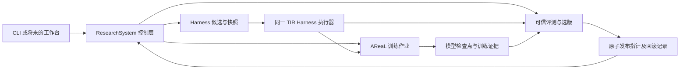

# 模型与 Harness 协同改进：最小 RSI 闭环设计

> 历史 RFC：从旧分支 `codex/model-harness-rsi` 恢复，保留原方案细节供追溯。文中有关 `ResearchSystem`、Ray、旧目录和“当前代码”的描述不代表 `dev/0928` 的现状。当前架构见 [architecture.md](architecture.md)，实测状态见 [implementation-status.md](implementation-status.md)。

状态：RFC 草案（2026-09-28）。本文描述目标架构和验收协议；首版代码采用 GRPO recipe，尚无真实 GPU 训练或能力提升证据。

## 1. 要解决的问题

系统从一个已冻结的 Agent 版本 `R0 = (M0, H0)` 出发，分析真实任务轨迹，提出并验证 Harness 候选 `H1`，利用 `H1` 产生的训练信号得到模型 `M1`，再独立比较模型与 Harness 的贡献。四组 `(M0,H0)`、`(M0,H1)`、`(M1,H0)`、`(M1,H1)` 中，只有通过预先登记的评测门槛的版本对才能成为下一轮起点；允许只晋升 Harness、只晋升模型或两者同时晋升，并分别标注结论。未通过的候选和失败证据保留，但不会改变当前发布版本。

这里的“递归”要求下一轮确实读取已晋升的模型与 Harness 身份，并基于上一轮的轨迹和失败记录继续改进；一次训练作业成功或一次 Harness 分数上升都不足以证明递归自改进。

首版只做一个任务域、一个研究员、一轮真实训练及下一轮起点检查。数据合成、多研究员、工作台和跨域自动迁移属于后续阶段。

### 两级验收

1. **工程闭环**：能产生 `H1`、真实训练检查点 `M1`、四组交叉评测和可恢复的晋升/拒绝记录。即使指标没有提升，也如实以 `completed_no_gain` 结束。
2. **能力提升**：在未用于搜索、训练和选版的封存题集上，预先登记的主指标及成本约束均通过。若要声称 Harness 能力进入模型，必须看到 `M1+H0` 相对 `M0+H0` 的留出提升；若要声称 `H1` 改善了训练，还需等预算的 `H0` 训练对照。

## 2. 首个任务、模型和优化范围

首个任务使用 AReaL 的 TIR（Tool-Integrated Reasoning）执行路径与 ToRL 题目。目标模型 `M0` 暂定为现有配方中的 `Qwen/Qwen2.5-Math-1.5B`；最终检查点、tokenizer、chat template、采样参数在预检后冻结。研究员/审查者可以使用另一模型，但该模型不得代替 `M0` 运行 Task 评测。已核对的 ToRL 源文件有 28,740/374 行；规范化题面去重后为 28,738/194 道训练/测试题，重复项答案相同。封存集规模较小，微小差异不能轻率解释为泛化提升。

`H0` 是完整的可执行 TIR Harness：实际进入模型的提示词、计算器工具描述和实现、工具结果格式、停止解析、最多两次工具回合、长度和超时。当前 TIR 配方默认 `is_chat_model=False`，使用 `TORL_PROMPT`；只修改 `SYSTEM_PROMPT` 不会改变实际输入。上游本地 Python 工具源码注明它**没有沙箱**，所以首版固定为 `calculator`，使用与之匹配的基线提示词；Python 执行只有接入经验证的独立沙箱后才开放。首轮 `H1` 只允许修改**实际生效的通用提示词和工具使用策略**，保持工具动作空间、回合数、采样预算、验证器和任务集不变。更广的工具/控制流修改必须在后续轮次单独评测。

这些选择优先保证一轮训练可运行、奖励可验证及模型/Harness 作用可区分。不能从 AReaL 的示例曲线推断本实验会获得同等提升。现有 TIR GRPO 配方按单节点八张 GPU 配置；实际资源缩减须经过可运行预检，不预先承诺单卡可训练。

## 3. 系统边界

- **RSI 控制层**拥有阶段状态、任务集授权、候选身份、作业意图、选版规则、发布指针和审计记录。Agent 可以提出假设和补丁，不能写可信分数或自行改变发布指针。
- **TIR 执行器**拥有模型输入构造、工具调用、结果注入和完整轨迹。Harness 搜索、AReaL rollout、最终评测使用同一份固定源码和版本化 Harness 快照；AReaL 只加薄的训练接口适配，不另写一套近似的 Agent loop。
- **AReaL**拥有首版 GRPO 的 GPU 训练、在线采样、权重更新和检查点；后续 SFT 沿用这一边界。RSI 记录并核验作业和产物身份，不把训练逻辑搬进研究员 Runtime。
- **可信任务侧**拥有答案、验证器和封存题集。研究员工作区只接收获准的题面、开发轨迹与汇总反馈。

本项目继续采用 `api/` 契约、`infra/` 实现、`ui/` 可选入口；`infra/research.py` 的 `ResearchSystem` 仍是系统入口。重建可删除与新主线无关的旧编排，但旧 run 数据、候选摘要、冻结协议和 source-lock 保持原样并只读归档。新闭环使用新 schema 版本与独立数据根，避免旧记录被新代码静默重解释。

首版已有冻结配置及 `run`、`status`、`report`、`rollback` CLI；CPU 资产预检由 `run` 自动执行，也可单独调用 AReaL recipe。`run` 以稳定 `run_id` 复用已经落盘的阶段结果，遇到 GPU 提交意图存在但无可信结果的外部作业时停下等待核对。`status` 仅报告回执是否存在，`report` 校验已保存评测的任务覆盖并汇总分数；两者不把文件存在解释为真实 GPU 成功。

## 4. 冻结身份与数据隔离

每个实验在第一次运行前保存不可变 `ExperimentManifest`。它至少绑定：

| 身份 | 必须记录的内容 |
| --- | --- |
| 模型 | 父检查点文件摘要、tokenizer/chat template、推理服务镜像或版本、训练后检查点摘要 |
| Harness | 完整目录摘要、工具 schema/实现摘要、执行器源码或 wheel 摘要、动作空间版本 |
| 任务 | 来源版本、标准化去重规则、每个 split 的任务 ID 和内容摘要 |
| 验证 | 验证器代码/配置摘要、答案格式、奖励定义、基础设施错误规则 |
| 推理和训练 | 采样温度、随机种子、回合/token/时间预算、SFT/GRPO 配置、AReaL 源码版本、GPU 作业 ID |
| 谱系与成本 | 父发布版本、候选来源、轨迹/评测引用、输入输出 token、工具调用、墙钟、训练资源消耗 |

模型权重较大时，`ContentRef` 可指向受控外部存储，但必须有可校验的文件清单；单凭目录路径、模型别名或 `/v1/models` 列表不能确认版本。凭证仅由受保护运行环境提供，不进入清单、候选或公开轨迹。

ToRL 的固定源数据分成下列互不重叠的集合；在预检时确认真实源数据、去重质量和数量后冻结任务 ID，本文不预设样本数：

| 集合 | 用途 | 向研究员暴露 |
| --- | --- | --- |
| `harness_evolve` | 反复诊断、修改 `H` | 题面、开发轨迹、验证反馈 |
| `harness_select` | 候选集冻结后一次性选 `H1`；按固定预算重复基线以估计波动 | 同代搜索期间不提供反馈；只由固定选择器读取汇总分数与成本 |
| `model_train` | 首版 GRPO 在线采样；后续可收集 SFT 轨迹 | 仅训练流程可读的题面；答案留在奖励侧 |
| `model_dev` | 选训练检查点、运行四组交叉评测 | 受控汇总结果，不能回流到 Harness 搜索 |
| `sealed_test` | 每代最终发布门槛 | 发布决定前研究员和训练器均不可见 |

优先从官方训练集划出前四组，将官方测试集留作 `sealed_test`。在任何拆分前，按题面和答案规范化并检查重复或近重复；跨 split 重复必须失败。封存集在同一代只用于一次事先登记的发布判定。若结果用于下一轮研究，下一轮需要新的未暴露审计题集。

## 5. 最小领域 API

首个提交 `a4d089b` 的 `ContentRef`、`ModelVersion`、`HarnessVersion`、`SolutionVersion`、`Task`、`TaskResult`、`Verifier`、`Evaluation` 是起点，不直接复制其完整字段或 Workflow。新的固定结构使用冻结的具名 dataclass/enum；JSON/dict 仅留在传输、插件和持久化边界。

| 契约 | 关键字段或行为 | 实现位置 |
| --- | --- | --- |
| `ModelVersion`、`HarnessVersion`、`AgentVersion` | 各自摘要、父版本；`AgentVersion` 固定 `(M,H,runner)` | `api/records.py` |
| `TaskSetVersion`、`TaskSplit` | 来源、split、任务 ID/摘要、授权范围 | `api/records.py` |
| `EpisodeRef`、`VerificationResult` | 轨迹/工具观察/输出引用；任务失败与验证器故障分别表示 | `api/records.py` |
| `EvaluationRequest`、`EvaluationReport` | Agent 版本、题集、验证器、种子和预算；逐题证据、聚合分数、成本和有效样本数 | `api/records.py` |
| `SftTrainRequest`、`RlTrainRequest`、`TrainJob`、`TrainResult` | 父模型、冻结 Harness、训练题集/轨迹、配置、作业身份、检查点和 lineage | `api/records.py`、`api/execution.py` |
| `PromotionDecision`、`ReleaseRecord` | 预登记门槛、四组比较、封存结果、发布/拒绝原因、回滚目标 | `api/research.py` |
| 控制请求 | 创建、预检、开始、暂停/恢复、状态、评测、晋升/回滚的 JSON 校验 | `api/control.py` |

`TrainRequest` 必须显式含 Harness 版本。原 `TrainingBackend.train(base_model, change) -> ContentRef` 既无法约束 `H1` 参与训练，也无法表达远端作业恢复、失败状态、训练轨迹和检查点选择。首版实现为 `infra/` 中的具体 AReaL 连接器；出现第二种真实训练实现时才抽出后端协议。

`HarnessRuntime` 与 `Benchmark/Verifier` 只保留有真实复用点的接口；TIR 域可以先用具体实现。公开 `Task` 不包含答案。`VerificationResult` 继承当前代码已具备的 `status` 语义：基础设施错误、超时或取消没有可比较的任务分数。研究员的 `propose` 只生成候选；正式 `select/promote` 由固定、可重放的策略执行。

## 6. 一代的执行协议

目标协议为显式阶段状态、作业意图与幂等键、可信终态和恢复查询。当前代码已在每个 AReaL 子进程前记录不可变意图并校验输出摘要；对无终态的外部作业采取停机核对，不自动查询或重新提交 Ray/Slurm 作业。

完整产品化时的主状态可细化为 `CREATED → PREFLIGHTED → BASELINED → HARNESS_SEARCHING → HARNESS_SELECTED → TRAINING → CROSS_EVALUATED → SEALED → PROMOTED | REJECTED`。当前最小控制器以不可变阶段产物和 `TirCycleOutcome` 表示进度，尚无完整的暂停/取消状态机。它区分 `no_harness_gain`、`no_model_gain`、`sealed_rejected` 和 `promoted`，不把无增益误报为晋升。

1. **预检**：核对任务、模型、tokenizer、Harness、奖励函数、GPU、服务网络和所有内容摘要；拒绝尚未准备好的训练。只读检查不算完成真实任务。
2. **基线**：用 `M0+H0` 在 `harness_evolve`、`harness_select`、`model_dev` 上运行固定采样；保存逐题轨迹、奖励、成本。对不变基线重复运行以估计噪声。
3. **Harness 搜索**：单研究员读取开发失败与成功轨迹，提出小范围 `H` 补丁；候选独立快照、静态检查、泄漏检查、烟测，在 `harness_evolve` 比较。候选集合冻结后，`harness_select` 按预设分数、成本和波动规则只选一次 `H1`；结果不能反馈给同代研究员继续改候选。借鉴 RRSI 的候选历史和保守选择，首版不复制其多域调度。
4. **RL 信号预检**：固定 `H1`、奖励和采样预算，在 `model_train` 上验证同题采样存在成功/失败差异，确认模型生成 token、工具观察、loss mask 和奖励一致。全零/全一奖励不能作为有效 GRPO 训练证明。
5. **AReaL GRPO**：以固定 `M0`、`H1`、tokenizer 和任务集进行在线采样与训练。首版预登记一个 epoch 和一个完整检查点；训练回执绑定父模型、Harness、runner、验证器、配置和检查点摘要。用 `model_dev` 判断能否晋升，绝不由训练 loss 代替任务成绩。
6. **交叉评测**：在相同执行器、题集、采样种子和预算下运行 `M0H0`、`M0H1`、`M1H0`、`M1H1`。保存逐题结果与无效作业数，基础设施故障不得被当作错误答案或零分。
7. **封存发布**：在打开 `sealed_test` 前锁定候选、指标、最小增益、成本上限及回归规则。可信评测器只执行一次四组对照；发布策略将完整版本对原子切换到获准的 `(M0,H1)`、`(M1,H0)` 或 `(M1,H1)`，或记录拒绝及当前指针。保留旧版本作为回滚目标。
8. **递归检查**：新建下一代时读取发布指针、父谱系和允许公开的失败摘要，证明起点为上一代获准版本；新封存题不能出现在任何祖先代的搜索、训练、开发或封存分组。未晋升时沿原版本继续，不把失败候选默认为新基线。当前代码已将跨代来源写入内容寻址发布记录并实现新封存题校验，仍需真实第二代运行验收。

### 后续 SFT 对照

在 GRPO 工程闭环得到真实结果后，增加 Harness-Zero 式审查者：学生在目标部署 Harness `H0` 的动作空间内运行，审查者只读 `H1` 通用指导和学生可见历史，必要时 `PASS/REPLACE` 下一动作。审查者不能读取隐藏答案、未公开环境状态或封存任务。仅可信验证成功、无越界信息的轨迹进入 AReaL SFT；工具观察、用户消息和审查者私有推理的 loss mask 为零。审查者替换动作不能直接当作 GRPO 原策略采样。SFT 与 GRPO 走同一四组评测及发布门槛，比较时须匹配训练题、token 和 GPU 预算。

## 7. 发布规则与证据边界

发布配置先选择主目标：`joint_performance` 比较获准版本对的任务成功率与成本；`model_internalization` 额外要求 `M1+H0` 超过 `M0+H0`。在 `model_dev` 上使用配对任务、固定采样配置、A/A 波动估计和预注册的成本/回归门槛选候选。`sealed_test` 只做发布确认；小样本差异和置信区间不足时结论为“不足以证明提升”，不能强行晋升。

四组交叉评测能区分 Harness 效应与模型效应；它本身**不能**证明 `H1` 比普通数据收集更适合训练。若需该因果结论，增加相同基础模型、任务、训练 token/GPU 预算及训练算法下的 `H0` 引导对照。

最终报告分列：已经实现并实际执行的步骤、论文或第三方声称、基础设施烟测、真实任务结果、封存集结果和无法验证的限制。一次 `train()` 成功、可加载检查点或绿色单元测试都不等于能力提升。

## 8. 复用与来源

- 当前项目优先复用内容寻址存储、冻结候选与可信验证结果绑定的**行为和测试**，重新审查与新记录的耦合；首个提交的版本对和 Task/Verifier API 提供领域模型起点。旧 `ResearchSystem` 的 pass@k/工作台流程不承担新一代训练控制。
- [RRSI](https://github.com/google-research/rrsi)提供 Harness 候选隔离、泄漏检查、噪声和成本选版的参考；其训练模型固定，因此不能直接充当模型训练控制器。
- [Harness-Zero](https://github.com/metaevo-ai/harness-zero)提供审查者修正轨迹和 SFT 数据构建的参考；它的训练是 SFT，审查者替换动作不能直接作为 on-policy RL 动作。
- [AReaL TIR](https://github.com/areal-project/AReaL/tree/main/examples/tir)提供目标 Agent 的工具执行与 GRPO 示例；训练/评测提示词和工具路径须先整理成可冻结的同一份 Harness。AReaL 的 `SFTTrainer` 与 SWE 轨迹 loss mask 代码可复用训练侧机制，但需针对 TIR 的真实渲染验证 token 对齐。

具体里程碑、资源前提和验收顺序见 [研发计划](model-harness-rsi-development-plan.md)。
