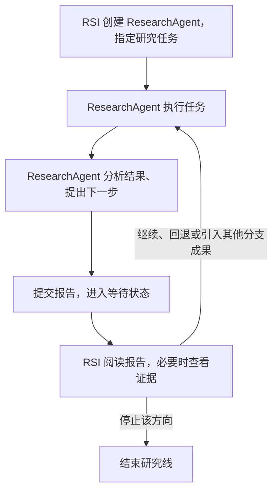

# RSI Agent 与 ResearchAgent 协作设计

阶段性设计，供评审。基于 `main@c02c886`（含 PR #18、#19）；以下描述目标流程。首步已实现 run 数据归属、通用 ResearchIteration 和 Agent 状态定义；任务协作、连续会话及 Evidence Pool 尚待后续实现。

**RSI Agent 负责整体统筹，ResearchAgent 负责沿指定方向深入研究。每轮研究完成后，ResearchAgent 上报并等待，由 RSI Agent 决定下一步。** 两者可以使用相同模型，通过职责和独立上下文分工。

## 1. 职责划分

| 角色 | 负责什么 |
| --- | --- |
| **RSI Agent** | 与用户交互、明确目标与约束、制定计划、解释实时进展；创建和停止 ResearchAgent，回复报告，整理公共经验，协调方向与成果合并，选择最终结果 |
| **ResearchAgent** | 沿指定方向执行 RSI 下发的任务，按实际需要使用工具与材料，上报具体结果和下一步建议，等待回复 |
| **Task Agent** | 当优化结果包含需要执行的 Harness 时，使用该 Harness 做题并产生输出；直接优化 kernel 等产物时可由执行环境直接运行产物 |
| **Workflow / 调度器** | 执行 Agent 决定，调用构建器和 Verifier，管理并发、等待、预算、取消、存储与恢复 |

沿用 PR #19 的 Interaction Agent 对话入口；RSI 负责 run 内的需求处理、研究统筹和进展解释，区分用户消息与研究报告。系统输出结构化进度元数据（run、Agent、节点、阶段、等待原因、指标、时间），由 CLI、Web 等自由消费；进度刷新不额外调用模型。

## 2. 主流程：任务 → 研究 → 上报 → 决策

创建 run 时固定目标、约束和正式比较规则，起点版本可为空。有起点且需要比较时，保存本 run 的 baseline 验证结果；没有起点时由 RSI 按目标安排首项任务。首个有效候选不能被倒填为已有的 baseline；缺少基线成绩时，相对提升不可计算。



RSI 在回复时也可以保存公共经验、创建其他 ResearchAgent，或将某条线的方案与经验交给另一条线。

**搜索方式。** 每个 ResearchAgent 对应一条研究方向，保持一个活动任务，默认深度优先推进。保留 `ResearchIteration` 名称，将它定义为一个通用研究节点，记录一项 RSI 任务及其执行。它不预设任务类型、执行阶段、产出形式或专用验证字段；具体行为由任务指令决定。

节点只保留身份、run / Agent 归属、父节点、任务引用、状态、报告引用、通用材料引用和时间。工具产生的记录由对应组件定义，通过统一引用关联到节点。节点完成表示任务完成，失败记录同样保留；回退及跨分支引入材料由 RSI 指定。

**EvolutionResult 是现有 Harness / Artifact 工作流可采用的结果格式，通用研究流程不需要它。** 当前工作流用它关联修改、评测和 SolutionVersion 的版本 ID；其他任务可以只提交自己的报告与材料，不生成 EvolutionResult，也不要求生成 SolutionVersion。可选的是结果格式，任务要求的汇报责任仍然保留。

**调度约定。**

- 一份任务明确研究范围、完成条件和预算；实际调用及重试都记录。任务结束后需要 RSI 回复才能开展下一项任务，不能用同一任务无限扩展研究。
- 报告落盘后进入 `waiting(rsi_reply)`。只有对应报告的有效继续指令才能启动下一轮；要求补充报告不代表允许继续尝试。这个规则由调度器执行，单 ResearchAgent 也不例外。
- 消息由调度器转交：RSI 的任务与回复作为 ResearchAgent 的 user 消息，ResearchAgent 的报告作为发给 RSI 的事件。上报后结束当前模型回合、保留会话，收件箱有新任务才唤醒；等待不发模型请求。
- 多条研究线异步运行；RSI 串行处理到达的报告，不等待所有分支完成同一轮。只有 RSI 能创建、继续或停止研究线；用户停止和硬预算限制由系统直接执行。
- 任务、报告和决定以 ID 关联，决定先落盘再执行。恢复不能重复下发已执行动作；停止后的迟到结果只归档，不自动重启研究。

版本和正式评测由独立组件记录，不展开为 ResearchIteration 的专门字段。每个 run 保存可空的 `best_result = 版本引用 + 正式评测引用`；只有满足同一比较规则的可信结果参与选优。最终确认与搜索期间最佳分别记录，节点是否完成按其任务要求判断。

## 3. 任务和报告：让 RSI 能直接作出决定

**RSI 下发任务**提供具体指令、相关材料与资源限制，指令说清目标、完成条件和允许操作。任务无需选择预设类别，也不填写产出类型或验证需求等专用字段。继续指令可以采纳 ResearchAgent 的建议，但不能只写“继续优化”。

**ResearchAgent 上报**必须清楚回答以下七项。正式指标由系统提供，ResearchAgent 负责分析与解释；所有关键结论都能追溯到证据。

| 内容 | 必须讲清楚什么 |
| --- | --- |
| 任务完成情况 | 上次要求了什么，完成和未完成哪些内容，是否偏离任务 |
| 具体工作 | 实际做了什么，操作对象、过程和范围足够明确 |
| 问题与处理 | 遇到什么问题，采取了什么处理，哪些仍未解决 |
| 实际结果 | 取得什么结果，哪些任务要求尚未完成；涉及量化结果时交代单位、条件与来源 |
| 结论与依据 | 哪些是已观察到的事实，哪些只是推测，对应哪些证据 |
| 下一步建议 | 继续、回退或停止；建议解决什么问题，如何判断下一项任务完成 |
| 公共经验候选 | 可供其他方向复用的结论、适用条件、证据和局限；没有则明确为空 |

例如，报告应写出“修改了尾块读取的 mask；公开开发测试从 19/20 到 20/20；正式正确性检查 100/100，通过同环境 30 次测量得到中位延迟 64 → 60 μs；尚无 profiler 证据证明改善原因”，而非“优化有效，建议继续”。这些数字仅为表达示例。

报告默认以 **400–800 个中文字的正文，必要时附关键指标表**为目标；简单情况可以更短，复杂材料存入 evidence。上述通用信息要求用于 prompt，不按任务类别切换报告结构，不要求为未涉及的业务流程填写空项。篇幅目标可调，不能通过截断丢掉关键失败或下一步。RSI 默认据此决策，仅在重要信息缺失、结论冲突或需深入诊断时读取原始轨迹。

## 4. 会话与 Prompt

RSI 在 run 内维持一个逻辑会话；**每条研究方向的 ResearchAgent 也维持连续会话和工作区**，RSI 是其任务发起者与 user。下一轮在原会话中追加回复和必要的新证据，不重放全部历史，也不每轮重建上下文。保存本轮轨迹与关闭会话是两个动作，只有研究线结束才关闭会话。

Prompt 保留四种职责明确的模板，并记录版本：

| 模板 | 核心要求 |
| --- | --- |
| RSI 角色 | 同时覆盖用户交互、计划、统筹和进展解释；依据报告决策，明确下发任务，区分事实和假设 |
| ResearchAgent 角色 | 专注指定方向，执行当前具体指令，依据实际记录汇报后等待 |
| Compact | RSI 保留目标、用户约束、方向选择与整体待办；ResearchAgent 保留当前任务、尝试结果、局部假设与 RSI 指令；均保留证据引用和覆盖位置 |
| 恢复 | 核对最新系统状态，接续摘要后的事件，恢复本角色待办，防止重复指令或跳过等待 |

Agent 状态定义为 `created / running / waiting / paused / stopping / stopped / failed`，另存等待原因、当前节点、逻辑会话和检查点引用。上报后是 `waiting(rsi_reply)`；主动暂停与等待回复分别记录。先定义数据语义，后续实现停止、恢复和消息调度。

上下文过长时，在回合完成并持久化后做 compact；正常轮次继续原会话，仅在 compact 或故障恢复需要时接续新的物理 session。原始记录保留，恢复输入由**最新状态快照 + compact 摘要 + 摘要之后的事件**组成。状态快照包含分支与任务状态、当前节点、最佳结果、未处理报告、未完成动作和预算。

恢复 prompt 的关键约定：

```text
你正在继续同一个 run。先核对目标、评测规则、分支状态、待处理报告和未完成动作。
最新持久化状态优先于旧摘要；摘要用于恢复研究理由，不能改写分数或执行状态。
不要重发已执行指令，不要让等待中的 ResearchAgent 绕过回复继续。
只检索解决当前缺口所需的记录，再处理下一事件。恢复本身不产生新的执行授权。
```

## 5. 统一评测边界：允许充分优化，保护验证机制

Harness 与具体产物使用同一条规则：**候选可以充分优化公开任务所允许的行为，但不能访问隐藏答案或干预 VALIDATE 的执行、比较和计分。** 领域差异放在执行组件与 Verifier 中，不改变 Agent 协作流程。

每个 run 固定一份评测契约，明确任务语义、允许优化范围、评分方式、可公开反馈和成功条件。针对公开允许的 shape 或输入范围优化是合法行为；利用隐藏用例、参考答案或评测内部状态返回结果属于作弊。

1. **执行隔离。** 验证固定候选快照；候选只接收合法任务输入，评测控制、答案和计时由独立可信环境持有。防护由执行后端实现，不能只靠 prompt 或文件只读。
2. **统一反馈。** 系统完整保存结果，按契约发布指标、错误类别等允许共享的信息。私有样本、期望输出、堆栈、轨迹和附件不自动公开；RSI 和 ResearchAgent 均遵守该边界，公共经验也不能绕过它。
3. **独立确认。** 搜索可反复获得受控反馈；最终固定候选使用未参与反馈的留出数据或新随机样本确认。控制评测预算，防止对反复查询结果过拟合；若确认失败后继续研究，旧确认数据不再算独立证据。
4. **结果可信。** 结果与缓存绑定候选、Verifier、配置、数据和执行环境的身份。基础设施故障不计为候选低分；运行错误与目标未达成分别记录。

kernel 的输入污染、参考缓存复用和计时干预等，由对应执行后端检查。同一通用边界覆盖这些行为，但不承诺仅凭有限测试发现所有作弊或证明全部输入正确。

## 6. Evidence Pool 与数据归属

**Evidence pool 是 run 内可共享材料与经验的索引。** 系统保存原始轨迹和正式结果；ResearchAgent 提出经验候选，RSI 决定哪些值得整理和分发。每条经验保留来源节点、证据引用、适用范围和局限，区分观察、假设与已验证结论。

ResearchAgent 可读取本轮材料、指定证据和已发布公共经验；RSI 可按需查看各分支的研究证据。跨分支引入原始材料由 RSI 指定，所有访问仍受评测隔离约束。经验被推翻时保留修正关系，默认不跨 run 共享。

| 归属 | 保存内容 |
| --- | --- |
| 根目录 `content/`、`versions/` | 不可变文件和版本，可被多个 run 引用 |
| `runs/<run_id>/` | 本 run 的目标、baseline、评测契约、状态、任务、报告、决定和搜索节点 |
| run 内 `evidence/`、`memory/` | 证据索引与有来源的研究经验，只在本 run 内默认共享 |
| run 内运行记录 | 各 Agent 状态、会话、compact、消息、决定、轨迹、工作副本及 worker 日志；完整私有验证材料单独保护 |

baseline 是 run 的可选引用，根目录现有 `baselines/` 可保留为旧 Harness 路径的版本去重索引。共享 DSH 安装、可跨 run 的前台会话和未启动计划留在根目录，具体研究的消息、暂停与恢复资料集中于 run。共享正文通过引用关联，导出完整 run 时需同时收集被引用内容。

最佳和最终结果可为空，不能因某节点没有版本就判任务失败。正式交付保存已确认版本与验证引用，需要文件目录时从快照导出。Memory 按 run 装配，不自动读取根目录的历史经验；经验内容引用证据，避免重复复制原始材料。Agent 通过受控工具访问材料，不直接获得整个 run 或数据根目录。

复用 PR #18 的验证结果、VerifierExecutor 和 TrajectoryStore 能力；`VerificationRequest` 等仍依赖 Solution 的接口需随版本模型演进。当前本地 Memory、会话和轨迹索引已按 run 装配；证据权限、反馈发布和执行隔离仍需完善。新轨迹 Store 的 `file://` 引用也需适配现有 `content://` 读取路径。新框架提供契约，尚未完成上述协作与安全机制。

**首个 demo：一个 RSI Agent + 一个 ResearchAgent，用同一 ResearchIteration 结构承载连续的不同任务，每轮具体上报并等待回复。** 具体工具按任务调用，不增加节点类别；随后验证中断与 compact 恢复，并扩展多研究线、经验共享和成果合并。

内部落地细节、完整 prompt、报告示例及分阶段 PR 计划见[实现参考](rsi-research-implementation.md)。
