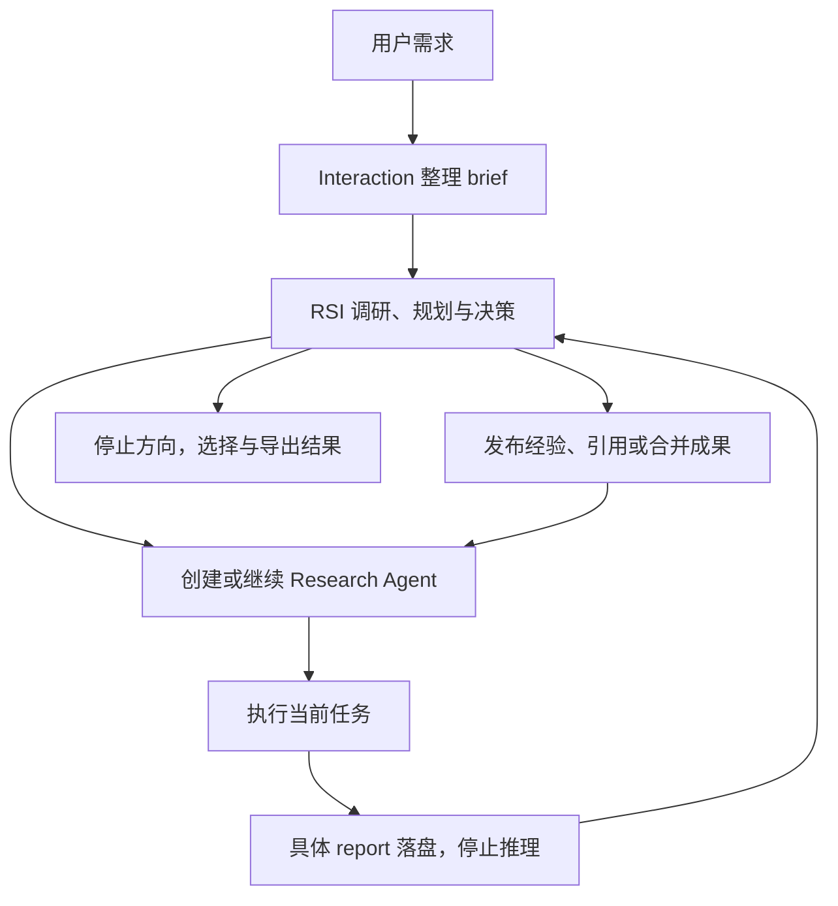

# RSI 多 Agent 研究设计

这一版对应开放式 Research 工作台。使用入口见[运行说明](research-workbench.md)，完整实现依据保留在[实现参考](rsi-research-implementation.md)。

**RSI Agent 自主组织研究；每条研究方向由一个连续会话的 Research Agent 承接。研究员提交具体报告后停止，只有 RSI 的明确回复才能开启下一项任务。**

## 1. 角色与需求

| 角色 | 职责 |
| --- | --- |
| Interaction Agent | 与用户对话，整理硬限制与给 RSI 的自然语言说明，解释真实进展；不指挥研究员 |
| RSI Agent | 联网调研、制定计划、按需创建或停止研究员、回复报告、共享经验、协调成果、选择交付结果 |
| Research Agent | 专注一条方向，执行当前任务，保留上下文与工作区，汇报具体工作和结果后等待 |
| Task Agent | 仅在执行被优化的 harness 时需要；使用固定目标模型和当前候选 harness 做题 |
| 调度与执行系统 | 落盘、消息投递、预算、并发、后台作业、取消、恢复与可信验证 |

Interaction 的输出分为两部分，原始对话同时保留：

- **TaskBrief 的硬限制**：研究员数量上限、GPU、作业并发、时间与 token 预算、允许修改路径、指标、target 和比较规则。
- **给 RSI 的说明**：优化意图、只改 skill 还是整个 harness、建议研究方向、偏好、取舍及不适合配置化的细节。建议与必须遵守的限制要区分。

启动前可以通过对话修改 brief；启动后硬限制与验证规则冻结，普通研究建议仍可转交 RSI。改变比较规则需要新 run，避免混用成绩。

## 2. 研究如何推进

RSI 自主决定何时调研、复现、实现、验证、深入一条线或并行探索，没有固定阶段顺序或任务分类。一条线同时只有一项活动任务；多条线异步推进，RSI 收到报告即可处理，不需要等所有研究员到齐。

`ResearchIteration` 表示一项 RSI 任务对应的通用节点：身份、父节点、任务引用、状态、报告引用、通用材料引用和时间。**节点可以没有候选、没有验证，也不要求产生 Solution。** 正常完成必须有具体报告；失败或取消保留已有材料与原因。

没有起点可以直接开始研究。有参考源码也不等于有 baseline；只有指定为起点且完成可比较验证后才有基线成绩。首个候选不能倒填为既有 baseline。

## 3. 报告与会话

RSI 下发任务时说清背景、具体指令、完成条件和相关材料。研究员报告包含七项：

| 内容 | 要求 |
| --- | --- |
| 任务完成情况 | 上次要求、已完成与未完成内容、偏离原因 |
| 具体工作 | 实际尝试或修改了什么，操作对象与范围 |
| 问题与处理 | 遇到的问题、尝试的处理、仍未解决的部分 |
| 实际结果 | 明确结果；涉及指标时写数值、条件与证据引用 |
| 结论与依据 | 区分观察、推断与未验证假设 |
| 下一步建议 | 建议做什么、为什么、何时算完成，或停止理由 |
| 公共经验候选 | 可复用结论、适用条件、证据与局限；允许为空 |

Prompt 以 400–800 个中文字或相近英文篇幅为参考，简单任务可更短；详细日志存为证据。过长报告拒绝后允许重新整理，不静默截断。

每个 Agent 使用一个持久逻辑会话。RSI 的任务和回复作为研究员的 user 消息追加；报告提交立即结束当前推理。等待任务或作业时没有模型请求，事件到达才恢复。RSI 可以在其他 Agent 工作时继续有用调研，空闲时同样可以显式等待。

消息与动作先落盘，稳定 ID 防止重复执行；停止后的迟到结果归档但不唤醒。compact 在新回合前或完整工具 batch 落盘后的安全边界缩短后续上下文，原文保留。恢复时使用摘要和最新状态，最新状态优先，不能重复授权或跳过等待。

## 4. 版本与可信验证

需要保存产物时创建不可变 `CandidateSnapshot`，记录内容与来源版本。工作区连续可变，验证始终运行冻结快照；切换到其他候选必须明确操作，不能覆盖未保存改动。

`VerifiedResult` 独立记录候选、契约、阶段、状态、分数和模拟标记。只有同一规则下成功且有效的 search 结果参与 run 内选优；基础设施失败没有成绩。最终确认与搜索最佳分开保存，需要 final 的任务必须由选定候选的有效 final 结果达到 target 后成功结束。达不到目标且没有值得继续的方向时，RSI 可用 `stop_run(reason)` 停止，保留最佳结果并说明未完成原因。

统一边界是：**自由优化允许的产物行为，保护 VALIDATE 的输入权限、执行机制与计分。** 领域差异由可信执行组件处理，不改变协作协议。Agent 不持有私有验证数据或任意评测命令，输出数字不能直接作为分数。

真实 final 池首次用于某候选后，不能再为另一个候选声称独立确认；继续研究后需新 run 与新 final 池。有限检查不能证明抵御全部攻击：当前 KernelBench 上游检查器仍在同一 Python 进程加载生成 kernel，尚不构成恶意 kernel 的完全隔离。CUHK-X 默认通过容器执行训练与匿名推理，由宿主可信评分。

旧固定 Harness / Artifact workflow 的 `EvolutionResult` 与 `SolutionVersion` 继续兼容。**EvolutionResult 是可选的 workflow 格式，开放研究不需要它。** 任务与报告分别存 Assignment 和 ResearchReport。

## 5. 数据与工作台

属于研究的状态集中在 `runs/<run_id>/`：brief、任务、节点、报告、候选记录、验证、会话、消息、事件、作业、证据和导出。不可变文件正文复用根目录 content；可变 memory 与共享经验不会跨 run 自动混用。GPU 分配只在根目录使用短时协调锁，占用事实仍属于各 run 的作业记录。

Evidence pool 保存可引用的事实与材料。研究员读取本线材料、RSI 指派的引用和已发布公共经验；RSI 决定共享什么，并保留来源、适用条件和局限。网页材料先实际抓取归档，不能用未读取的链接冒充证据。

本地 Web 展示用户对话、当前计划、研究方向、搜索图、节点任务与报告、证据、作业、最佳和最终成绩、预算与等待原因，支持暂停、恢复、停止及导出。展示来自结构化状态和事件，刷新不额外调用模型；原始会话和私有验证资料不直接暴露给前端。

两个示例共用以上流程：KernelBench 优化通用 harness 并调用固定 Task Agent；CUHK-X 由 RSI 检索论文、安排研究与训练，直接验证候选模型，无需 Task Agent。GPU 模拟只检验协作与工程链路，不代表真实性能。
