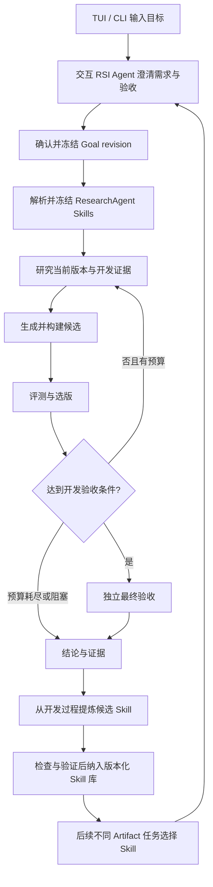

# AReaL-RSI Goal 模式、双 Target 闭环与 Skill 复用方案

日期：2026-10-15  
状态：实现方案与验收契约草案。本文中的新增 API、命令、配置项和效果阈值均为拟实现内容，不代表已经交付或实测达标。

## 1. 目标与已确认范围

让用户通过 TUI 或 CLI 描述生产目标，由前端交互 RSI Agent 澄清需求、允许修改范围、验收标准和预算；确认后持续研究、实施、评测和选版，直到达标、预算耗尽、用户停止或遇到阻塞。

本次交付：

1. Goal 持续迭代模式，不依赖或直接集成 Codex Goal 服务。
2. TUI 多轮澄清；CLI 类似 `rsi exec`，支持交互追问和非交互调用。
3. 跑通 Harness、Artifact 两种 target；Model 定义接口并完成契约测试，不执行真实训练。
4. Harness、Artifact 各一个真实 demo，展示每轮改动、效果、证据和选择结果。
5. ResearchAgent 加载版本化 Skill；从 Artifact 生产中提炼 Skill，在不同的后续 Artifact 任务中复用并评价收益。

用户价值以质量、达标时间、计算消耗和人工投入衡量。轮次、Agent 数、生成的 Skill 数量只是运行信息，不能作为成功标准。

默认单研究线；用户明确选择时继续支持多线。确认后的范围内自动推进，不逐轮索要确认。Web 保持本地只读，交互控制统一通过 TUI/CLI。

## 2. 当前代码基础与缺口

| 模块 | 已实现事实 | 本次补齐 |
| --- | --- | --- |
| `ui/dsh.py`、`resources/dsh/persona.md`、`ui/mcp.py` | DSH Interaction Agent，通过 MCP 生成和确认计划、管理后台实验 | 需求与验收澄清、Goal revision、共享交互服务 |
| `ui/cli.py` | `tui/run/resume/status/web`；`run` 接收已有计划 | 自然语言 `exec`、非交互协议、Goal 生命周期命令 |
| `config.py` | 当前工作区已加入 `~/.areal_rsi/config.json` 加载，环境变量优先 | Skill 配置和路径解析；该配置改动与本文均尚未提交 |
| `api/base.py` | Plan、Run、版本、研究修改和轮次记录 | Goal、预算、验收、停止原因与 Skill 身份 |
| `workflows/evolution.py` | TRAIN、提案、构建、VALIDATE、选版、逐任务检查点、多线剪枝 | 真正的目标验收、预算与阻塞判断、最终评测 |
| `workflows/artifact.py`、`modules/artifact.py` | Artifact 版本构建及固定 Model/Harness 的约束 | 默认应用装配、产物执行器与验收环境 |
| `agents/research/artifact.py` | Artifact 提案 Agent | 可配置 Skill、产物生产与经验提炼链路 |
| `app.py` | 默认装配 Harness、算术或 GSM8K 评测 | 按 target 构造完整上下文 |
| `api/modules.py` | `TrainingBackend.train()`；另有 `ModelChange` | 训练任务状态、取消、恢复与 checkpoint 契约 |
| `ui/web.py`、`ui/static/` | 基线、逐轮分数、改动理由、版本 ID | Goal 验收、diff、产物截图、Skill 使用和复用证据 |
| `AgentSpec.skills`、`modules/runtime_package.py`、`modules/runtime_worker.py` | 可传 Skill 文本；DSH 有 Skill 时启用插件 | ResearchAgent 实际注入，目录资源、版本冻结与适配器能力检查 |

必须修正的语义：

- 当前轮数耗尽但没有异常也会得到 `RunState.SUCCEEDED`；它表示执行完成，不等于目标达成。
- 当前 ResearchAgent 创建 `AgentSpec` 时没有传 `skills`。能修改目标 Harness 的 `skills/*.md` 不等于研究者加载了自己的 Skill。
- Artifact 组件存在不等于默认 TUI/CLI 已能运行；需要装配相匹配的 ResearchAgent、Builder、执行器、Benchmark 和 Verifier。
- 当前 Web 的 TRAIN 分数属于本轮输入版本，而 VALIDATE 分数属于候选版本；展示时必须明确版本，不能当成同一版本的两项成绩。

## 3. 总体流程与职责



职责划分：

- **交互 RSI Agent**：复用现有 Interaction Agent；澄清任务、验收、预算，解释结果。TUI 保留原生 DSH 交互，不增加一个模型转述层。
- **GoalService**：共享的确定性服务，管理草稿、确认、版本、状态和执行授权。TUI/MCP 与 CLI 都调用它。
- **后台 RSI Agent**：基于可见证据提出继续、探索、剪枝或阻塞建议；不能修改已冻结的评分规则或自行宣布达标。
- **ResearchAgent**：使用已绑定 Skill 和开发证据提出修改，提交候选、选版建议和经验候选。
- **Workflow 与 Verifier**：执行、记录、校验、计算预算与判定目标是否达成。
- **Skill 库**：保存可复用的方法及资源、版本、适用条件和使用效果；不是隐藏答案库或生产任务的源码备份。

## 4. Goal 契约与持续运行

### 4.1 数据对象

| 对象 | 必需内容 |
| --- | --- |
| `GoalSpec` | 目标描述、target、输入资产、允许修改范围、不可改变项 |
| `AcceptanceSpec` | 指标、比较方向、阈值、必过项、验收器版本、最终评测协议 |
| `BudgetSpec` | 最大迭代次数、执行时长、有限重试次数 |
| `GoalRevision` | 草稿/确认状态、澄清记录、确认来源、配置与资产摘要 |
| `GoalOutcome` | 是否达标、停止原因、交付版本、验收报告、资源消耗 |
| `ResearcherSpec` | 模型与 Runtime 身份、Skill 版本集合、工具能力 |
| `IterationEvidence` | 输入/候选/下一轮版本、改动、评测、选版理由、Skill 使用、耗时 |

Goal 可以关联多次恢复执行，但同一 revision 的标准、输入基线和 Skill 集合不随文件修改而改变。实际计划由服务生成，用户不手填内部版本 ID。

### 4.2 状态和停止规则

Goal 状态：`draft → needs_input/ready → running → achieved/budget_exhausted/blocked/failed/paused/cancelled`。允许 `paused` 恢复为 `running`；`blocked` 在依赖解决后显式恢复。草稿修改产生新 revision。

- 达到轮次或时间上限必须标记 `budget_exhausted`，不能标记目标达成。
- 必过项全部满足、所需评测完成且证据有效，才可标记 `achieved`。
- 缺少工具、数据或权限等可操作阻塞，输出缺口及恢复条件；临时错误有限重试，不能无上限循环。
- 低分或一轮未提升不是阻塞；保留探索和回退能力。
- 暂停后不派发新工作，取消当前可取消操作并保存已有检查点；恢复不重做已落盘结果。
- 中途调整目标、Skill 或验收标准生成新 revision，保留旧记录；不得沿用不匹配的缓存。
- 旧 Run 的 `succeeded` 不自动迁移为 Goal 的 `achieved`，缺少独立验收时显示“历史运行已完成，目标达成未验证”。

### 4.3 预算和评测边界

首版强制执行轮数、时间及重试预算。新操作派发前检查剩余预算，运行中使用剩余时间超时；记录取消宽限期造成的额外时长。Token、费用仅在后端可观测时记录，不可用时显示未知，不能宣称精确费用限额。

开发任务供 ResearchAgent 分析；VALIDATE 用于候选比较，提供聚合结果；独立最终评测不参与搜索。确认开发条件满足后冻结最佳候选，再执行最终验收。最终验收失败结束本次正式评价，不将隐藏题目或反馈回流到当前搜索；继续改进需新 revision，并避免重复使用已暴露的最终评测集。

冻结 benchmark、任务清单、verifier、模型、Runtime、目标基线、研究 Skill 集合等摘要。扩大现有缓存身份校验，不能仅凭任务名或版本 ID 复用评分。

## 5. TUI 与 CLI

拟新增命令：

```bash
# 交互澄清、确认和监控
rsi tui
rsi exec "提高当前 Harness 的数学任务准确率" --target harness
rsi exec "完善这个任务管理网页" --target artifact --artifact ./app

# 自动化提交完整契约
rsi exec --spec goal.json --yes --json

# 生命周期与补充信息
rsi goal status GOAL_ID
rsi goal answer GOAL_ID --answers answers.json
rsi goal pause GOAL_ID
rsi goal resume GOAL_ID
rsi goal cancel GOAL_ID
```

- TUI 与交互终端可多轮追问；CLI 非交互调用缺信息时返回 `needs_input`、问题列表、草稿 ID，不无限等待输入。
- `--yes` 授权执行完整且通过校验的契约，不能跳过缺失条件。
- `--json` 的 stdout 输出 NDJSON 事件及最终结果；诊断日志走 stderr。每条事件带 schema 版本、Goal/Run ID 和事件类型。
- 拟定退出码：0 达成，2 输入/配置无效，3 需要补充输入，4 预算耗尽，5 阻塞，6 执行失败，130 用户中断。退出码只表达本次调用结果；持久状态是恢复依据。
- 两个入口启动同一个后台 worker 实现，使用互斥锁与幂等请求防止重复提交。CLI 默认附着输出，断开不应误报 Goal 失败；显式取消使用生命周期命令。
- `~/.areal_rsi/config.json` 存机器、模型、Skill 库配置；Goal 文件存任务契约，不保存认证信息。
- 保留 `rsi run --plan` 底层入口；更新帮助与文档，普通用户无需手写 Plan 内部字段。

## 6. Harness、Artifact、Model 的装配

在 `app.py` 提取 target 装配注册表，按目标选择基线、ResearchAgent、Builder、执行器、Benchmark、Verifier 和 Workflow。复用版本管理、任务检查点、worker 和选版机制。

| Target | 允许变化 | 必须固定 | 本次交付 |
| --- | --- | --- | --- |
| Harness | Prompt、Skills、工具、MCP 配置 | 模型、评测任务与验收器 | 可通过两种入口运行，真实效果 demo |
| Artifact | 显式产物目录中的源码与资源 | 模型、执行 Harness、验收器、非目标产物 | 完整导入、构建、执行、验收及交付 |
| Model | 模型权重或 adapter | 任务、验收器及契约约定的 Harness | 接口、模拟后端契约测试 |

Artifact 导入先保存不可变基线，ResearchAgent 在独立工作区修改，Builder 生成候选版本。网页 demo 增加构建/启动/浏览器执行组件和确定性 Verifier；不得要求用户手动拼装完整 `WorkflowContext`。

Model 基于已有 `ModelChange`、`TrainingBackend.train()` 补充任务提交、状态查询、取消、恢复和 checkpoint 交付契约；绑定训练配置、数据摘要、父模型版本与资源需求。未安装后端时明确拒绝运行，不退回其他 target，不生成假 checkpoint。

## 7. ResearchAgent Skill 加载与沉淀复用

### 7.1 区分三个概念

1. **ResearchAgent Skill**：研究者使用的方法，例如需求分解、网页实现、浏览器诊断和测试设计。
2. **目标 Harness Skill**：被优化系统的能力，是 Harness target 的可变资产。
3. **Artifact**：本次用户交付物，例如一个网页。它的源码不是自动生成的研究 Skill。

Artifact 生产可产生研究 Skill 候选，用于后续任务，但不能因此修改当前实验已经冻结的研究者身份。

### 7.2 配置与选择

拟在 `config.json` 增加以下结构化字段；当前配置解析器仅对 `RSI_AGENT_MODELS` 支持对象，因此需要显式扩展解析，不能直接把该结构转成普通环境字符串后忽略。

```json
{
  "RSI_RESEARCH_SKILLS": {
    "library_root": "~/.areal_rsi/skills",
    "paths": ["~/.areal_rsi/skills/web-artifact-production/1.0.0"],
    "selection": "explicit",
    "capture_candidates": true
  }
}
```

- 首版默认显式选择，所有研究线使用同一冻结 Skill 集合。
- 交互 Agent 可以根据库中的名称、描述和适用范围推荐 Skill，在 Goal 确认时一并确定；不实现不可审计的自动全量加载。
- Goal 可显式覆盖默认集合，包括空集合，便于做无 Skill 对照实验。
- 路径支持 `~`，配置路径解析规则写入文档。已启动实验从快照读取，不依赖原始目录继续存在。
- `api_key`、认证文件、原始生产数据和隐藏验收答案不进入 Skill 包。

### 7.3 加载实现

新增 `SkillLoader` 和版本化库模块，完成：

1. 读取 `SKILL.md` 的名称、描述、适用范围和前置依赖。
2. 打包 `SKILL.md`、`scripts/`、`references/`、`templates/` 等目录资源，生成内容摘要和 `SkillVersion`。
3. 校验路径边界和包大小；拒绝逃逸目录的符号链接。显式装配资源，不自动执行安装脚本。
4. 冻结 Skill 清单到 `ResearcherSpec` 和 Goal revision，并将目录快照放进内容存储。
5. 在 ResearchAgent 工作区物化只读 Skill 资源，把 Skill 描述/入口传入 `AgentSpec.skills`，确保相对资源路径能解析。
6. ResearchAgent 的提案会话使用所选 Skills；选版会话默认只使用选版规则与聚合证据，不自动注入与选版无关的生产 Skill。
7. 为 Runtime 定义 Skill 能力检查。首版验证 DSH 的真实加载、资源读取和脚本调用；其他适配器只有通过对应测试后才声明支持，否则明确报能力不支持，不能静默丢弃。

验收不能只检查 `AgentSpec.skills` 非空，必须在轨迹中看到真实加载与至少一次资源使用。记录“已配置”“已加载”“已调用资源”，分别展示；无法观测的语义影响不伪造为已使用。

### 7.4 从 Artifact 生产中提炼 Skill

在候选经过开发评测、或生产结束后，使用已有修改和开发证据生成 Skill 候选。失败尝试可以沉淀适用边界和失败模式，不把失败方法包装为已有效方案。

每个候选至少包含：

- 来源 Goal、Run、轮次、Artifact 版本和开发证据引用。
- 解决的问题、适用条件、不适用场景与前置依赖。
- 可迁移步骤、必要脚本/模板、验证方法。
- 已知失败模式，以及本次生产中哪些证据支持或反对该方法。

提炼不能读取隐藏最终评测明细，不复制题目答案、项目专属业务数据或凭证。来源代码只有在适合复用且来源可追溯时才提取为通用模板。

Skill 提炼使用单独记录的预算，来源 Goal 的生产预算与提炼预算都计入总体成本；提炼失败不把已经验收成功的 Artifact 改为失败。候选自动保存，但不会自动进入下一任务的默认集合。

### 7.5 Skill 生命周期与验证

生命周期：`candidate → validated → active → deprecated`。

- `candidate`：成功打包、记录来源，不表示方法有效。
- `validated`：通过结构、依赖、资源可执行性和适用场景测试；必须标明是否已有跨任务收益证据。
- `active`：用户或预先授权策略选择用于后续任务的具体版本。
- `deprecated`：发现不适用或回归后停止默认推荐，历史实验仍能恢复该版本。

同名 Skill 更新创建新版本，不覆盖旧包。首次正式验收采用用户显式激活；Goal 启动前确认版本，启动后固定。记录每次选择理由、资源调用、任务结果及失败边界，支持回退。

拟提供命令：

```bash
rsi skill list
rsi skill inspect SKILL_ID --version VERSION
rsi skill validate SKILL_ID --version VERSION
rsi skill activate SKILL_ID --version VERSION
```

### 7.6 跨任务复用验收

Artifact demo A：任务管理网页，生产过程提炼“本地状态管理、交互边界与持久化验证”等通用 Skill。

后续任务 B：书签管理网页，具有相似技术需求但不同业务对象与独立验收用例，不能直接复制 A 的最终交付物代替生产。

对任务 B 做冻结对照：

- 相同模型、Runtime、初始代码、验收器、预算、研究线数量和工具。
- 一组不加载候选 Skill，一组加载指定 Skill 版本。
- 禁止对照组继承 A 的研究 Memory、轨迹、生产结果；隔离工作区和缓存，确认唯一实验差异为 Skill。
- 至少做 3 对配对运行；支持种子时固定种子，不支持时记录采样配置与运行次序。
- 主指标预先选定：同等质量下达标时间降低，或固定预算下验收质量提高。报告所有运行，不挑选最优个例。
- 建议效果门槛：两组都达到全部必过项，Skill 组达标时间中位数降低至少 20%，且 Token/费用与人工时间无实质回归；不可观测成本明确标注。
- 若有未达标运行，报告成功率和未达标比例，不能只在成功子集中宣称提速。固定预算质量比较需预先声明为另一协议。
- 单独报告一次性的 Skill 提炼/验证成本，以及后续复用收益；一次复用节省不等于已经摊平总成本。

这些数字是建议验收门槛。开发预检后、正式对照前冻结；未达到则只能宣布加载复用功能通过，不能宣布 Skill 已提升生产效率。三对运行属于 demo 证据，不据此宣称普遍统计显著。

## 8. 两个真实效果 Demo

### 8.1 Harness demo：固定模型的多步算术与结构化输出

- 从明确标注的最小可用 Harness 开始，只允许修改 Prompt、Skills、工具和 MCP。
- 预检后冻结模型、数据清单、验收器和预算。不得故意削弱已有强基线制造收益。
- 建议任务规模：TRAIN 30 题、VALIDATE 30 题、最终留出 60 题；分区去重，隐藏答案留在 Verifier。
- 建议预算：一条研究线，最多 5 轮、30 分钟。
- 建议验收：最终留出正确率至少 90%，较同条件基线提高至少 10 个百分点，结构化输出合规率 100%。
- 基线已经饱和时，在正式实验前更换有区分度的任务，不事后降低门槛。
- 最终评测同时评价冻结基线和选定候选；最终结果不再参与当前选版。
- 每轮展示 diff、输入/候选版本、开发与验证分数、典型开发样例和耗时；独立最终评测单独展示。

### 8.2 Artifact demo：任务管理网页

- 导入标明未完成功能的基础版本，用真实模型生产代码。
- 验收涵盖新增、编辑、完成、筛选、持久化、空输入与边界处理、桌面与移动端布局。
- 用确定性浏览器操作检查功能与布局约束；截图展示外观，不用截图主观宣称审美提升。
- 建议预算：一条研究线，最多 5 轮、30 分钟。
- 验收：全部必过功能项通过，已有功能无回归，冻结的桌面/移动端布局检查通过，无阻塞交互的运行错误。
- 每轮保存源码快照、diff、截图、评测摘要和可预览版本。
- 完成 Skill 候选提炼、检查与显式激活，并运行第 7.6 节的后续任务 B 对照。

两个 demo 均允许失败轮次、退化与回退；不要求每轮增长，不为凑轮数延迟达标停止。真实效果未过门槛时，保留证据，明确标记效果验收未通过。

## 9. 可视化

扩展现有 `ui/web.py` 与 `ui/static/`：

- 顶部展示目标、验收标准、状态、预算消耗、停止原因和最终交付版本。
- 曲线支持按轮次与执行时间查看，区分候选表现、历史最佳和最终独立验收。
- 轮次详情展示输入版本、候选版本、下一轮版本、修改理由、diff、必过项与失败原因。
- Artifact 提供每轮桌面/移动端截图与版本预览。可执行页面使用独立来源或受限 iframe 隔离，不能访问面板数据和任意本地文件。
- Skill 面板展示配置版本、加载/资源使用证据、来源任务、候选状态、后续复用结果和对照指标。
- 明确区分自动执行时间、人工参与时间、Skill 提炼成本及不可观测成本。
- 展示数据从真实运行记录投影，不生成虚构分数；离线回放标注历史运行及配置摘要。
- 每轮记录和最终报告均可追溯到 Goal revision、Run、Solution、SkillVersion 和 Verifier 身份。

## 10. 实施工作包与交付物

| 顺序 | 工作包 | 主要修改范围 | 交付物与退出条件 |
| --- | --- | --- | --- |
| P1 | Goal 契约、状态与 Model 接口 | `api/base.py`、`api/workflow.py`、`api/modules.py`、新增 Goal 模块 | schema、状态转换、确认/预算/版本规则；Model 模拟后端契约通过 |
| P2 | 统一交互服务与 CLI | `ui/cli.py`、`ui/mcp.py`、`ui/experiments.py`、DSH persona | TUI/CLI 澄清同一 Goal，非交互可补信息，worker 幂等提交与恢复 |
| P3 | ResearchAgent Skill 加载 | `config.py`、新增 Skill 库模块、ResearchAgent、Runtime 适配 | 包加载、资源路径、快照冻结、DSH 真实资源调用；不支持适配器明确报错 |
| P4 | Target 装配与 Goal 执行 | `app.py`、workflows、Artifact 执行/验收组件 | 两个 target 均可从产品入口运行；范围约束、预算与最终验收生效 |
| P5 | Skill 提炼与后续复用 | Skill 库、经验提炼服务、事件记录 | candidate 到 active 生命周期，来源证据和跨任务选择可追溯 |
| P6 | 两个 demo 与可视化 | `examples/`、`ui/web.py`、`ui/static/`、浏览器验收 | Harness/Artifact 实测报告、每轮证据与 Artifact B 对照 |
| P7 | 综合验收与文档 | `tests/`、README、接口和运行指南 | 故障恢复、入口一致性、历史兼容、可复跑命令及验收报告 |

默认目录建议：`goals/` 保存契约和 revision，`goal-events/` 保存事件，现有 `runs/` 保存迭代数据；共享 Skill 库在 `~/.areal_rsi/skills`，每次运行的 Skill 快照与绑定保存在该实验的数据根目录中。具体文件布局在 P1 冻结。

## 11. 验收清单

| 类别 | 通过标准 |
| --- | --- |
| 澄清与确认 | 模糊请求补问关键缺口，完整请求不重复追问；确认内容可追溯；未确认或缺必需字段不运行 |
| 持续执行 | 未达标且有预算时继续；预算、阻塞、异常和用户操作各有明确结论；正常结束不误报达标 |
| 双入口 | TUI/CLI 共享 Goal 和后台 worker；同一提交不重复启动；非交互无意外等待，JSON 输出可解析 |
| 暂停与恢复 | 在评测、构建、选版阶段中断均可恢复；已落盘任务不重做；未落盘外部操作使用幂等键或明确重执行边界 |
| 缓存与身份 | 任务、验收器、模型、Runtime、基线、Skill 变更不复用不匹配缓存；旧记录不被覆盖 |
| Target 隔离 | Harness 不改模型；Artifact 不改模型/Harness/非目标资产；越界修改拒绝 |
| Skill 加载 | 真实会话加载 Skill 并使用目录资源；路径错误明确失败；不支持的 Runtime 不静默忽略 |
| Skill 冻结 | 源文件更新或删除不改变已确认运行；恢复使用原快照；新版本只影响新 revision |
| Skill 沉淀 | 候选有来源、方法、适用边界、失败条件和验证记录；隐藏验收内容及凭证不进入包 |
| Skill 复用 | 不同任务成功加载指定版本；对照隔离其他经验；完整报告收益、回归、失败和提炼成本 |
| 验收完整性 | 超时、缺失证据、评测错误不当成功；验收器不能被候选修改；最终评测不回流当前搜索 |
| 可视化 | 展示数值、版本、截图、Skill 状态与原始记录一致；失败和回退可见，最终评测与选版评测分开 |
| Model 接口 | 模拟后端覆盖提交、状态、取消、恢复与父版本/checkpoint 关系；明确未验证真实训练 |
| 真实效果 | Harness、Artifact、跨任务 Skill 复用分别出具冻结协议下的报告；各项未过门槛不能用单元测试通过代替 |

验证分三层：离线单元/契约测试，真实 Runtime/浏览器集成测试，真实模型效果与跨任务复用测试。沿用项目 Ruff、Mypy 和测试套件；可视化要做浏览器交互验证。三层结果分别记录，不能将模拟组件分数报告为真实生产收益。

## 12. 最终交付标准与实施前置条件

最终交付包括实现代码、两个 demo 的可复跑入口、Goal 与 Skill 配置说明、逐轮可视化、独立验收报告、Skill 版本包和后续任务对照报告。运行所用模型、数据、基线、预算、版本摘要及人工参与记录必须齐全。

当前没有需要用户进一步决定才能设计的阻塞项。真实运行前需准备有效模型连接和浏览器执行依赖；开发预检后冻结任务及效果门槛。以上建议阈值在正式验收前确定，不在看到正式结果后修改。
